# What the 150 CFD cases show

13 October 2026. Teaching version for Stephen Eacuello. Faculty summary: [TEAM_SUMMARY.md](TEAM_SUMMARY.md).
Files and reruns: [README.md](README.md).

**Scope.** 150 finished 2D URANS cases (OpenFOAM v2606, `pimpleFoam`):

- 51 smooth blade-section cases (Stage 1);
- 43 roughness cases (Stage 2);
- 56 rotor cases (Stage 3: 16 static, 40 rotating).

140 ran on Unity and 10 on the Mac. Every number comes from the merged tables in `data/` through
the scripts in `src/`. An independent script per stage (`src/*_verify.py`) recomputed each number;
`src/team_summary_check.py` recomputed the numbers of TEAM_SUMMARY.md and those added in the review
of 13 Oct. Where a check corrected a claim, this document uses the corrected claim. The case folders (time
histories, fields) were not read, because they were still downloading.

**Labels.**
- Provenance:
  - *computed* (from the tables);
  - *measured* (wind tunnel, 1 Oct 2026, from the roughness report);
  - *literature*;
  - *assumed*;
  - *inferred*;
  - *estimated*.
- Strength:
  - **established**: the tables show it and it survives the checks made, within the 2D model;
  - **indicative**: supported, but an untested factor could change it;
  - **unresolved**: the difference is not larger than its noise, or no usable run exists.

"Not resolved" bounds a difference. It never means "equal".

## What did we learn

The 2D CFD does not explain the fuzzy-skin power gains, and it cannot yet test the mechanism
proposed for them. In the fully turbulent models, roughness made the convex (returning) side of the
blade draggier, by up to 5.8 % with rough wall functions (established within these models) and
13.7 % with the 0.20 mm texture meshed into the wall (indicative: no time-step check). With the wall
functions, this and a lower concave-side drag reduced the concave–convex drag difference that drives
a drag rotor by 19.3 % at Ks 400 µm (computed; established within these models). On a quasi-steady
rotor model that is a power loss (inferred), whereas the tunnel measured gains of +12.8 % and
+16.2 % (measured). The transition model, the only one here that can show roughness tripping the
boundary layer, found no texture effect larger than its noise at 23 m/s; with the convex side to the
wind it has no healthy Stage 1 run and only four short texture-mesh runs at 23 m/s (unresolved).
Three numerical findings limit every absolute value (established): 23 of the 51 smooth-section runs
are corrupted; with the cup into the wind, the 2D flow settles into one of two states whose drag
differs by a factor of about 1.8, which go with the time step (confounded with the machine at
23 m/s), the mesh and Tu; and the grid study does not converge at α 0 or 180. Of the four
combinations of assembly hypothesis and rotation sense, the 2D rotor is shown to deliver power from
rest only with the arms on the concave face and the curled tip leading. It reaches zero torque at
λ 0.159 ± 0.008, at the rig's light-load λ at 23 m/s (a lower bound), but not the rig's higher λ at
38 m/s (indicative). The measurements that would change these conclusions most are a blade-section
force or pressure test, the rotor's assembly and bearing friction, and the FS 0.40/0.80 round with
replicated prints.

## Contents

1. [Questions, cases and terms](#1-questions-cases-and-terms)
2. [Stage 1: the smooth blade section](#2-stage-1-the-smooth-blade-section-51-cases)
3. [Stage 2: roughness on the section](#3-stage-2-roughness-on-the-section-43-cases)
4. [Stage 3: the 2D rotor](#4-stage-3-the-2d-rotor-56-cases)
5. [Numerical quality](#5-numerical-quality)
6. [Limits of 2D URANS and of these models](#6-limits-of-2d-urans-and-of-these-models)
7. [Conclusions](#7-conclusions)
8. [What to do next](#8-what-to-do-next)

---

## 1. Questions, cases and terms

### 1.1 Questions

From the meeting with Prof. Jahangiri on 7 Oct ([PLAN.md](../../PLAN.md)):

1. Which runs can be trusted?
2. What are the lift, drag and shedding frequency of the smooth blade section, and do they match
   published data?
3. Does roughness change the section forces, and in which direction?
4. Does the 2D rotor reproduce the rig's tip-speed ratios, and which assembly fits?
5. Can the CFD explain, or test, the measured fuzzy-skin gains? The proposed mechanism is roughness
   tripping the boundary layer.

Section 7 answers them in this order.

### 1.2 What was run

| Stage | Table | Cases | Unity / Mac | What varies |
|---|---|---|---|---|
| 1 Smooth section | `section_polars.csv` | 51 | 47 / 4 | α 0–345° in 15° steps (LM, 23 m/s); U 10.2/23/38 m/s and Tu 0.5/1/3 % at α 0 and 180 (SST, LM); mesh coarse/medium/fine and maxCo 5/2.5 (SST, α 0/90/180) |
| 2 Roughness | `stage2_polars.csv` | 43 | 42 / 1 | rough wall function (SST): Ks 0/50/100/200/400 µm at α 0/90/180 and 23 m/s; α 0 also at 10.2 and 38 m/s; maxCo 5 and 2.5 at α 0 (27 cases). Resolved texture: t 0/0.05/0.10/0.20 mm, SST and LM, α 0 and 180, 23 m/s (16 cases) |
| 3a Rotor, static | `rotor_static.csv` | 16 | 11 / 5 | blade azimuth θ 0–105° in 15° steps, assembly hypotheses A and B, 23 m/s |
| 3b Rotor, rotating | `rotor_cp.csv` | 40 | 40 / 0 | λ 0.05–0.30; A at 10.2/23/38 m/s, B at 23 m/s; both rotation senses; maxCo 4, plus 2 repeats at maxCo 2 |

Three cases started on the Mac and finished on Unity, and the tables label them `unity`:
- section α 90 SST medium maxCo 5 (moved at 138.5 of 150 c/U);
- rotor B θ 30 static (moved at 0.415 of 0.437 s);
- Stage 2 α 180 Ks 50 (moved at 0.236 of 0.313 s).

Eight cases diverged at maxCo 5 and are not in the tables: the three fine-mesh section runs, and the
Stage 2 α-0 runs at 23 m/s (Ks 0, 100) and 10.2 m/s (Ks 0, 100, 200). They were re-run at maxCo 2.5,
under names ending `_Co2.5n2` ([RUN_JOURNAL.md](../../docs/RUN_JOURNAL.md), 12 Oct).

Common set-up:
- incompressible URANS (`pimpleFoam`);
- adaptive time step at a fixed maximum Courant number (maxCo);
- free-stream Tu 1 % and length scale 1 mm, held at the body by decay control (assumed: the
  tunnel's Tu is not measured).

Details: [section2d](../../section2d/README.md), [stage2](../../stage2/README.md) and
[rotor2d](../../rotor2d/README.md) READMEs.

### 1.3 Terms used throughout

- **α**: angle of attack.
  - α 0: cup (concave side) into the wind.
  - α 180: convex side into the wind.
  - α 90: edge-on, tip A first.
- **Cd, Cl, Cm**: per unit span on c_ref = 48 mm; Cm is about the section centroid,
  counter-clockwise positive. The published shell values use the frontal width (48.76 mm at α 0
  and 180), so multiply our α-0 and α-180 values by 0.984 to compare (computed).
- **The two turbulence models**:
  - SST (kOmegaSST) treats the boundary layer as turbulent from the leading edge. It stands in for a
    fully tripped layer.
  - LM (kOmegaSSTLM, γ–Reθ) lets the layer start laminar and predicts transition. It is the only
    model here that can show tripping.
  - Background: [LEARNING_LOG §3](../../docs/LEARNING_LOG.md#3-k-omega-sst-and-the-gamma-retheta-transition-model).
- **maxCo**: the solver sets each time step so that the flow crosses at most maxCo cells per step,
  so halving maxCo halves the time step
  ([LEARNING_LOG §5](../../docs/LEARNING_LOG.md#5-courant-number-and-time-step)).
- **c/U**: one convective time, 2.1 ms at 23 m/s. Section and wall-function runs last 150 c/U and
  average the last 100 c/U. Texture runs last 80 c/U and average the last 50 c/U.
- **Flagged run**: a run whose numbers are corrupted (§2.2). The output column is named
  `corrupted`. A **healthy run** is one that is not flagged; healthy does not mean converged.
- **High-drag state, low-drag state**: the two flow states with the cup into the wind (§2.3).
- **Drag difference D** = Cd(α 0) − Cd(α 180): the section quantity that drives a drag rotor (§3.3).
- **Two-position model**: a quasi-steady teaching model of a drag rotor.
  - It uses only two blade positions: the advancing cup sees (1 − λ)U, and the returning convex side
    sees (1 + λ)U.
  - Drive N = Cd(α 0)(1 − λ)² − Cd(α 180)(1 + λ)².
  - N = 0 at λ0 = (√k − 1)/(√k + 1), with k = Cd(α 0)/Cd(α 180).
  - It ignores lift, the other azimuths, blade-blade interaction and the third blade.
- **Ks**: the sand-grain roughness of the rough wall function. **t**: the texture amplitude meshed
  into the wall, i.e. the nominal fuzzy-skin texture, not the measured one.
- **Drift rule** (Stage 2): a change between runs a and b is resolved when it exceeds
  |drift_a| + |drift_b|. The drift is the mean of the second half of the averaging window minus the
  mean of the first half. That sum is called the **noise** of the change.
- **Rotor terms**:
  - λ = ΩR/U, with R = 101.6 mm.
  - C_Q and C_P are per unit span on 2R.
  - **Drag-rule sense**: the rotation sense in which the cup opens against its motion (A: CW, B: CCW
    in the model frame). **Reversed sense**: the opposite.
  - **2u**: twice the averaging uncertainty of a rotating mean, from the revolution-to-revolution
    scatter.
- **Light-load λ** (rig): the largest λ at any load step at one wind speed, from the tachometer
  record of every load step. Generator torque and bearing friction act even at light load, so it is
  a lower bound on the rig's aerodynamic zero-torque λ.

---

## 2. Stage 1: the smooth blade section (51 cases)

### 2.1 What was run, and why

The section is the building block of the rotor. Its drag with the cup into the wind (α 0) and with
the convex side into the wind (α 180) sets the torque of a drag rotor, and testing the tripping
idea needs SST and LM side by side.

The runs:
- **The 360° polar**: 24 LM runs at 23 m/s, α 0–345° (the section is not symmetric), medium mesh,
  maxCo 5.
- **Speed and turbulence**: α 0 and 180 at 10.2, 23 and 38 m/s with SST and LM (Tu 1 %), and at
  Tu 0.5 and 3 % with LM.
- **Grid**: SST at α 0, 90 and 180, 23 m/s, on coarse, medium and fine meshes at maxCo 2.5.
- **Time step**: the same SST cases at maxCo 5 on the coarse and medium meshes.

### 2.2 First, which runs can be trusted: 23 of 51 are flagged

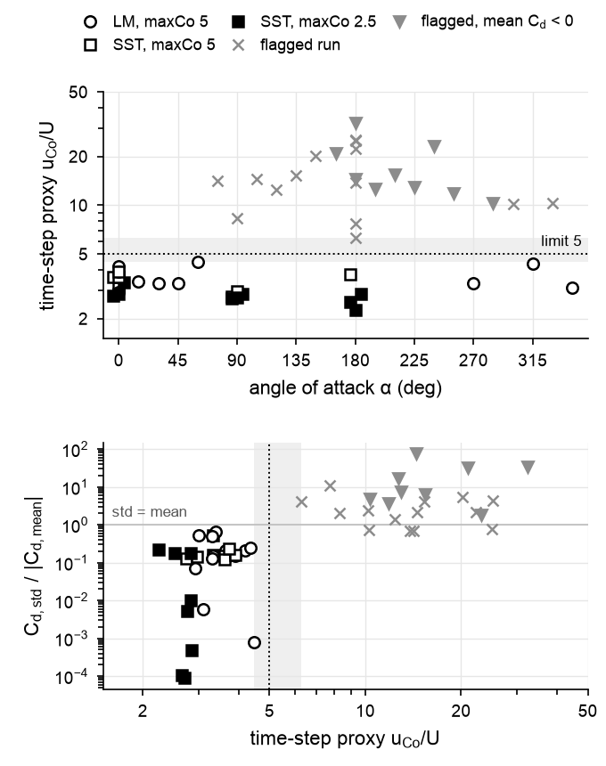

**How to read.**
- *Top panel*: the time-step proxy u_Co/U for every run, against α (log scale).
  - The proxy converts a run's mean time step into the speed, in units of U, that would set it in a
    corner-sized cell: u_Co/U = maxCo · dx_corner / (dt_mean · U).
  - Black symbols are healthy runs, grey × are flagged runs, and grey ▼ are flagged runs with
    negative mean drag.
  - The empty grey band separates the two groups; the dotted line is the limit of 5.
- *Bottom panel*: the drag fluctuation relative to the mean drag (Cd_std/|Cd_mean|), against the
  same proxy.
  - Most flagged runs sit above the "std = mean" line or have negative drag.
  - Four flagged runs sit just below it, at 0.69–0.75, but still above the healthy maximum of 0.65.

**Finding** (computed; established that the runs are unusable; the cause is inferred).
- **Where.** 23 runs are flagged, all medium-mesh runs at maxCo 5 (23 of 39). None of the coarse
  maxCo-5, maxCo-2.5 or fine runs is flagged (0 of 12).
- **Clean split.** Healthy runs have a proxy of 2.25–4.48 and flagged runs 6.27–32.3, with nothing
  in between. The flagged runs' mean time step is 1.9–9.6 times smaller than the median of the
  healthy medium maxCo-5 runs.
- **Symptoms.** Each flagged run has at least one further symptom, and no healthy run has any:
  - 9 have negative mean drag (down to −1.93);
  - 19 have Cd_std > |Cd_mean| (Cd_std up to 65.9);
  - 5 have |mean Cl| > 3 (down to −10.16);
  - 21 have a time-mean maximum y+ above 2.
- **Angle more than model.** All 8 α-180 medium maxCo-5 runs are flagged (3 SST, 5 LM), and none of
  the 8 α-0 runs. 20 of the 23 are LM runs (20 of 32 LM runs). In the LM polar, α 75–255, 285, 300
  and 330° are flagged.
- **Worse with refinement.** For the matched SST cases (23 m/s, α 0/90/180), maxCo 5 flags 0 of 3
  runs on the coarse mesh and 1 of 3 on the medium mesh, and all 3 fine-mesh runs diverged.

**Physics.**
- **The time step as a signal.** The time step is a speed limit set by the flow. If a run's step
  shrinks several-fold, something next to the wall is moving far faster than in healthy runs.
- **Impossible drag.** A fixed body in a steady stream cannot have negative mean drag: drag times
  wind speed is the energy the body takes from the flow (literature: momentum and energy balance).
- **The cause.** It is inferred to be spurious oscillation near the square corners, where the smoke
  test found the largest Courant numbers ([section2d README §3](../../section2d/README.md)). The
  fields were not inspected.

**A correction to the run journal** (established for the mechanism; the timed-out cases are
identified by inference).
- **The claim.** The 12 Oct journal says the LM cases' time steps (0.14–2.2 µs) were small "because
  the transition model is far stiffer".
- **The mechanism.** In OpenFOAM v2606 the adaptive time step depends only on the face fluxes
  (checked in the source, `setDeltaT.H` and `CourantNo.H`). Every run was Courant-limited
  (time-mean maximum Co 0.991–1.000 × maxCo).
- **The comparison.** Healthy LM runs step as fast as healthy SST runs:
  - median dt·U/c is 1.40e-3 for LM and 1.36e-3 for SST;
  - in the one matched pair in the same flow state (α 0, 38 m/s), dt is 1.515 µs for LM and
    1.521 µs for SST.
- **The timed-out runs.** The 12 LM runs that carry a restart signature, i.e. the timed-out cases
  (inferred), are all flagged. They were slow because they were corrupted. The fix is a smaller
  maxCo, not a longer time limit.
- **The re-run cost** (estimated, from the three healthy medium maxCo-2.5 SST runs). A healthy
  maxCo-2.5 re-run needs about 144,000–181,000 steps, 4.5–7.3 h on Unity. The flagged runs took
  200,665–1,098,317 steps.
  - LM, 20 of the 23 re-runs, costs more. The healthy LM medium maxCo-5 runs took 2.7–6.2 h on
    Unity. If halving maxCo multiplies their steps as it did for SST (1.6–1.8 times, α 0 and 90),
    an LM re-run takes roughly 4–11 h (estimated; `src/team_summary_check.py`).

**What it means.** Only the 28 healthy runs enter any comparison below. No healthy LM run exists
between α 75 and 255°. That range includes α 180, where roughness is most expected to act.

### 2.3 Cup into the wind (α 0): two flow states

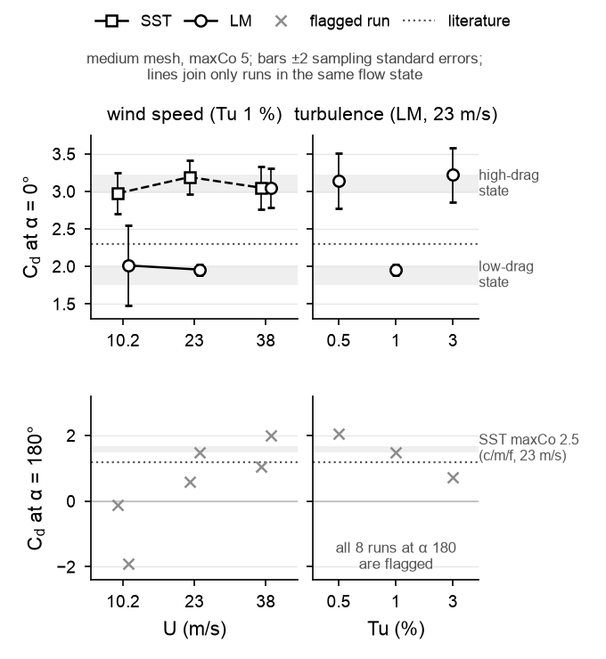

**How to read.**
- *Top row*: Cd at α 0 against wind speed (left; SST squares with a dashed line, LM circles with a
  solid line) and against Tu (right; LM).
- *Bottom row*: the same at α 180. Every run there is flagged, and the grey band is the healthy SST
  maxCo-2.5 range, shown only for orientation.
- *Bars*: ±2 sampling standard errors (Cd_std/√cycles). They assume one independent sample per
  shedding cycle, so they understate the uncertainty of a run that may switch state.
- *Grey bands at α 0*: the Cd ranges of the two flow states over all 12 healthy α-0 runs.
- *Dotted line*: the literature shell value.
- *Lines*: they join only runs in the same state.

**Finding** (computed; established that two states exist; unresolved which is physical). The 12
healthy α-0 runs fall into two separate clusters:

| | High-drag state (7 runs) | Low-drag state (5 runs) |
|---|---|---|
| Cd | 2.97–3.22 | 1.75–2.01 |
| Mean Cl | −0.70 to −0.27 | +0.02 to +0.18 |
| Cl_std | 0.81–1.49 | 0.003–0.45 |
| Cm | 0.32–0.39 | 0.16–0.19 |
| St | 0.118–0.144 | 0.124–0.157 |
| Cd on the frontal width, against the shell value 2.3 | 2.93–3.17 (+27 to +38 %) | 1.72–1.98 (−25 to −14 %) |

- **What separates the states.** Cd, mean Cl and Cm separate them; St does not, because its ranges
  overlap.
- **The time step goes with the state.** For SST at 23 m/s, the maxCo-5 run is in the high-drag
  state and the maxCo-2.5 run in the low-drag state on both meshes tested. The machine changes as
  well (asymmetry below), so the time step is the likely trigger, not a proven one (inferred):
  - coarse: 3.1682 → 1.7951 (−43.3 %), with Cl_std 0.836 → 0.0031;
  - medium: 3.1905 → 1.7508 (−45.1 %), with Cl_std 0.857 → 0.0052.
- **No single setting decides.** At maxCo 5, LM is in the low-drag state at 10.2 m/s and at 23 m/s
  with Tu 1 %. It is in the high-drag state at 23 m/s with Tu 0.5 and 3 %, and at 38 m/s. The mesh
  family matters too (§3.7).
- **Two noisy members.** Only 3 of the 5 low-drag runs are near-steady. Two fluctuate more than any
  high-drag run, so their means may mix both states:
  - SST fine at maxCo 2.5: Cd_std 1.02;
  - LM at 10.2 m/s: Cd_std 1.05, with a drift of 15 % of the mean.
- **Size of the gap.** On matched pairs the two states differ by a factor of 1.76–1.82 in Cd.

**Asymmetry to keep in mind.** At 23 m/s, both maxCo-5 runs ran on the Mac and all maxCo-2.5 runs
on Unity, so the time step and the machine are confounded there. The SST maxCo-5 runs on Unity at
10.2 and 38 m/s are also in the high-drag state, which points to the time step (inferred).

**Physics** (inferred; no fields were examined).
- **Two patterns.** A 2D bluff-body wake can sustain more than one pattern.
  - The high-drag state has a large mean lift (−0.3 to −0.7) and a strong lift oscillation (Cl_std
    about 1), i.e. a strongly asymmetric shedding wake.
  - The low-drag state has nearly zero mean lift, and in 3 of 5 runs almost no oscillation.
- **Selection.** Small numerical differences decide which pattern a run locks into, like a ball
  settling into one of two valleys.
- **Real flow.** At Re_c 3.2×10⁴–1.2×10⁵ the real flow is three-dimensional and less coherent than
  in 2D URANS.

**Which state is real?** This is unresolved; the weak evidence favours the high-drag state
(inferred). Two indirect hints:
- **The rig's tip-speed ratio.** The two-position model needs the high-drag values to reach the
  rig's light-load λ (§2.5, §3.8).
- **The usual URANS bias.** 2D URANS usually overpredicts bluff-body drag. The healthy α-180 runs do
  (+21 to +37 %), and so does the high-drag state at α 0 (+27 to +38 %). The low-drag state would
  instead mean that the CFD underpredicts the concave side while overpredicting the convex side.

Neither hint is a measurement of this blade. A tunnel measurement of the section's α-0 drag would
settle it.

**What it means for the tunnel.** The concave-side drag drives the rotor, and the CFD cannot yet say
whether its coefficient is about 1.75 or about 3.2. Absolute CFD torque and power should not be
trusted until this is settled.

### 2.4 Grid and time step

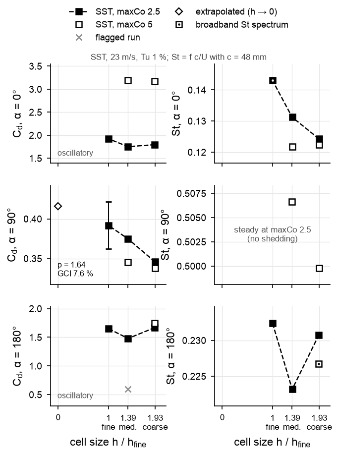

**How to read.**
- *Set-up*: SST, 23 m/s, Tu 1 %. The left column is Cd and the right column St; the rows are α 0,
  90 and 180.
- *x axis*: the relative cell size h/h_fine = √(N_fine/N): fine 1, medium 1.39, coarse 1.93.
- *Filled squares on a dashed line*: maxCo 2.5, the grid study.
- *Open squares*: maxCo 5. The vertical gap to the filled square is the time-step effect.
- *Open diamond at h = 0* (α 90 only): the Richardson-extrapolated value. The bar on the fine point
  is its GCI.
- *Square with a centre dot*: a broadband lift spectrum, so its St is less certain.
- *Grey ×*: the flagged medium maxCo-5 run at α 180.

**Grid** (computed; established that grid independence is not shown). The procedure is that of
Celik et al. (2008) ([LEARNING_LOG §8](../../docs/LEARNING_LOG.md#8-mesh-independence-and-the-gci)).
- **α 90 converges.** Cd converges monotonically: 0.3459 / 0.3748 / 0.3919 (coarse / medium /
  fine), with apparent order p 1.64, extrapolated value 0.416 and GCI_fine 7.6 %. Cm at α 90 also
  converges monotonically, but with p 0.27 and GCI 23.7 % (not plotted).
- **α 0 and 180 oscillate.** Cd at α 0 (1.795 / 1.751 / 1.925) and at α 180 (1.669 / 1.479 / 1.653)
  zig-zag, with spreads of 9.0 % and 11.5 % of the fine value. No order or GCI exists.
- **Cl diverges** at α 0 and 90: the change grows with refinement.
- **The medium mesh at α 180 is the outlier.** It is 11 % below coarse and fine, has the lowest St
  peak share (0.65, against 0.96 and 0.87) and the largest instantaneous y+ of any maxCo-2.5 run
  (4.94). All LM, speed and Tu runs use this mesh.
- **Caveat.** All three levels keep the first cell at 4.5 µm and change the growth ratio, so the
  refinement is not geometrically similar near the wall. The apparent orders are warnings, not
  results.

**Time step** (computed; established that maxCo 5 is not time-step independent; the size of each
change is indicative). The comparison is maxCo 5 → 2.5 on the same mesh, SST, 23 m/s. Except at
α 180 on the medium mesh, each maxCo-5 run ran wholly or mostly on the Mac and each maxCo-2.5 run on
Unity, so the time step and the machine change together:
- α 0: the state changes (−43 to −45 %).
- α 90: the shedding stops. Cl_std falls from 0.121 to 1.0e-4 (coarse) and from 0.139 to 2.8e-5
  (medium), and the fine run is also steady. Cd changes by +2.3 % and +8.6 %, and Cl by −7.2 % and
  −14.9 %.
- α 180 (coarse): Cd −4.6 %, St +1.8 %.
- α 180 (medium, both runs on Unity): the maxCo-5 run is flagged (§2.2) and the maxCo-2.5 run is
  healthy.

maxCo 5 is therefore not time-step independent on these meshes; the same-machine α-180 medium pair
shows it without the machine confound. Whether maxCo 2.5 is converged is untested, because no
maxCo-1.25 run exists. Every LM run is at maxCo 5.

**What it means.** The tunnel differences between blade sets are 2–16 %. A CFD difference smaller
than about 10 %, the grid spread at α 0 and 180, cannot be resolved across meshes. Within one mesh,
as in every roughness comparison here, it holds only if the grid error cancels between the two
runs, which is untested (inferred).

### 2.5 Convex side into the wind (α 180), and the drag ratio

**α 180** (computed; indicative).
- **Agreement.** The three healthy maxCo-2.5 SST runs at 23 m/s agree on a shedding wake:
  - Cd 1.48–1.67 (coarse 1.6691, medium 1.4794, fine 1.6531);
  - St 0.2232–0.2324.
- **Against the literature.** On the frontal width, Cd 1.456–1.643 is 21–37 % above the
  half-cylinder shell value of 1.2 (literature, as quoted in PLAN.md; not this blade). That is the
  usual 2D-URANS overprediction.
- **Missing model.** Stage 1 has no healthy LM run at α 180. The only other LM runs at α 180 are the
  four 80-c/U texture-mesh runs of Stage 2 at 23 m/s (§3.4), so the transition model has barely been
  tested where roughness should matter most.

**Physics.**
- **The path.** With the convex side into the wind, the boundary layer runs about 95° of arc from
  the stagnation point to each tip (computed).
- **The analogy.** On a circular cylinder a laminar layer separates near 80° and a turbulent one near
  120° (literature, e.g. Achenbach 1968; not re-checked).
- **What tripping could do** (inferred). It could move separation from the curved surface toward the
  tips and narrow the wake. This is the mechanism the tripping idea relies on.

**The drag ratio** (computed; unresolved against the literature). For each matched pair (same mesh,
model, maxCo and speed), k = Cd(α 0)/Cd(α 180), and λ0 is the two-position model's zero-torque λ:

| Pair (SST, 23 m/s) | α-0 state | k | λ0 |
|---|---|---|---|
| coarse, maxCo 2.5 | low-drag | 1.075 | 0.018 |
| medium, maxCo 2.5 | low-drag | 1.183 | 0.042 |
| fine, maxCo 2.5 | low-drag | 1.164 | 0.038 |
| coarse, maxCo 5 | high-drag | 1.811 | 0.147 |
| literature shells, 2.3/1.2 | – | 1.917 | 0.161 |

The other 8 matched pairs (medium, maxCo 5) are unusable because their α-180 run is flagged.

**Against the rig** (inferred).
- **The requirement.** The rig's light-load λ is 0.158–0.160 (Plain, 23 m/s, runs 2 and 1).
  Friction makes the aerodynamic zero-torque λ larger still, so the model needs k ≥ 1.89 (1.91 for
  0.160).
- **The literature ratio** meets it.
- **The high-drag pair** falls 7 % short in λ0 (0.147 against 0.158), about as much as the radius
  uncertainty below moves the requirement.
- **The low-drag pairs** miss by a factor of 3.8–8.7.
- **The radius.** The model's radius is itself uncertain. At the blade's mid-radius, the needed k is
  1.82 under assembly A and 2.03 under B (computed).

### 2.6 The 360° polar (LM, 23 m/s)

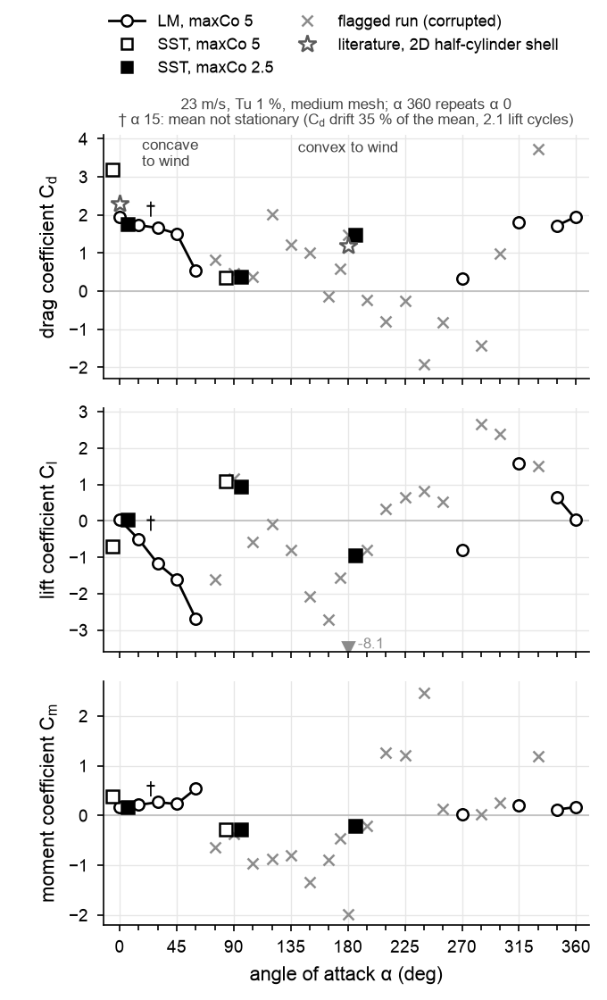

**How to read.**
- *Open circles joined by a line*: healthy LM runs (medium, maxCo 5). Lines join neighbouring healthy
  angles 15° apart.
- *Grey ×*: flagged runs, plotted at their meaningless values. The grey triangle at the edge is
  an off-scale flagged value (α 180, Cl −8.1).
- *Squares*: SST at 0, 90 and 180°. Open squares are maxCo 5, drawn 6° left; filled squares are
  maxCo 2.5, drawn 6° right.
- *Stars*: the literature shell Cd at 0 and 180° (frontal width).
- *†*: α 15, whose mean is not stationary.
- *α 360* repeats α 0.

**Finding** (computed; indicative). The healthy LM angles are 315, 345, 0, 15, 30, 45, 60 and 270°.
All are at maxCo 5 on the medium mesh, with no time-step or grid check at these angles.

| α (°) | 315 | 345 | 0 | 15 † | 30 | 45 | 60 | 270 |
|---|---|---|---|---|---|---|---|---|
| Cd | 1.817 | 1.725 | 1.957 | 1.734 | 1.660 | 1.511 | 0.539 | 0.333 |
| Cl | +1.574 | +0.649 | +0.030 | −0.504 | −1.173 | −1.606 | −2.682 | −0.798 |

- **Trends.** From 315° to 60°, Cd falls as the cup turns away from the wind, and Cl changes sign
  through α 0. The least-squares Cl slope over −45 to 45° is −0.0363 per degree (−2.08 per radian).
- **Point quality.**
  - α 0 is in the low-drag state.
  - α 15 holds only 2.1 cycles of a slow oscillation (drift 35 % of the mean), so its mean is not
    converged.
  - α 60 is steady.
- **The rest of the polar** (75–255°, 285, 300, 330°) needs maxCo-2.5 re-runs.

**Use.** A blade-section test of lift and drag against α would be compared with this.

### 2.7 Shedding frequency (for the accelerometer test)

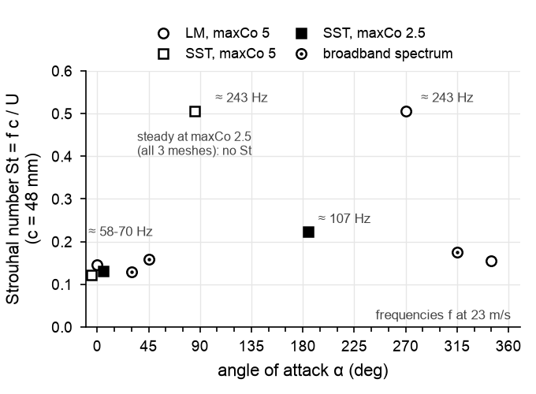

**How to read.**
- *Axes*: St = f c/U (c = 48 mm) against α, for the healthy medium-mesh runs at 23 m/s and Tu 1 %
  whose lift spectrum has an identifiable peak (the other meshes, speeds and Tu are in the text).
- *Symbols*: circles are LM; squares are SST (open maxCo 5, filled maxCo 2.5). A centre dot marks a
  broadband spectrum.
- *Labels*: the frequency at 23 m/s.

**Finding** (computed; indicative).
- **By angle.** St is 0.118–0.157 at α 0 (0.122–0.147 at 23 m/s), 0.223–0.232 at α 180 (maxCo 2.5,
  three meshes) and 0.500–0.507 at α 90 and 270.
- **On the frontal width** (48.76 mm at α 0/180, 21.77 mm at α 90/270), α 90, 180 and 270 all give
  St 0.227–0.236, while α 0 gives 0.12–0.16.
- **Time-step caveats.**
  - The α-90 shedding exists only at maxCo 5: the runs are steady at maxCo 2.5 on all three meshes.
  - α 270 (LM) has no maxCo-2.5 check.
  - Only the α-180 value has been checked against the time step.

Frequencies, f = St U/c, from the 23 m/s St ranges at constant St (computed; at 10.2 m/s the LM
α-0 run gives 33 Hz, at 38 m/s both α-0 runs give 93–94 Hz):

| α | 10.2 m/s | 23 m/s | 38 m/s |
|---|---|---|---|
| 0 | 26–31 Hz | 58–70 Hz | 96–116 Hz |
| 180 | 47–49 Hz | 107–111 Hz | 177–184 Hz |
| 90, 270 (maxCo 5 only) | 108 Hz | 243 Hz | 401 Hz |

**Sampling** (computed from the Nyquist limit):
- **α 0 and 180.** 400 Hz covers them up to 38 m/s (at most 184 Hz).
- **Edge-on.** If the edge-on shedding is real, it needs at least 490 Hz at 23 m/s and at least
  810 Hz at 38 m/s.
- **PLAN.md.** Its 30–160 Hz estimate is too low at 38 m/s.

**Physics** (literature idea, applied as an inference). Bluff bodies shed at roughly the same St
when it is based on the width of their wake. α 0 sheds more slowly on the frontal width, which fits
the cup turning the flow outward at the tips into a wider wake.

### 2.8 Wind speed, turbulence, and SST against LM

**Wind speed** (computed; unresolved).
- **SST at α 0** (all in the high-drag state, medium mesh, maxCo 5):
  - Cd 2.9746 at 10.2 m/s (Re_c 3.23×10⁴), 3.1905 at 23 m/s (7.28×10⁴) and 3.0485 at 38 m/s
    (1.20×10⁵);
  - the changes against 23 m/s are −6.8 % and −4.5 %, i.e. −1.2 and −0.8 combined standard errors.
- **LM at α 0** switches state with speed: 2.013, 1.957, 3.045.
- **α 180**: all six speed runs are flagged.

No Reynolds-number effect is resolved, which is not the same as no effect.

**Turbulence** (computed; unresolved).
- **LM at α 0, 23 m/s**: Cd 3.140 (Tu 0.5 %), 1.957 (1 %), 3.223 (3 %). This V shape is the state
  switch, not a smooth turbulence effect (inferred).
- **α 180**: all three Tu runs are flagged.
- **The free stream held.** The upstream probe read 0.5065–0.5151 %, 1.0012–1.0171 % and
  3.0047–3.0111 % for the targets 0.5, 1 and 3 %.

**SST against LM** (computed; unresolved).
- **The only fair pair.** The one matched pair with both runs in the same state is α 0 at 38 m/s,
  both in the high-drag state: Cd 3.0485 against 3.0446 (−0.13 %, with 2 combined standard errors of
  about 13 %), and St −0.8 %.
- **Result.** No transition-model effect is resolved.
- **Unfair pairs.** The −32 % and −39 % differences at 10.2 and 23 m/s compare different states, not
  different models.

**Pressure drag dominates** (computed; established).
- **The numbers.** Viscous drag is −0.53 to +1.47 % of Cd in all 28 healthy runs:
  - α 0: −0.49 to −0.13 %;
  - α 90: +0.39 to +1.47 %;
  - α 180: +0.87 to +1.09 %.
- **Consequence** (inferred). Skin friction alone cannot produce power changes of 13–16 %. A
  roughness effect must act through separation and the pressure field.
- **For the test plan.** Pressure taps would capture almost all of Cd.

### 2.9 What Stage 1 means for the tunnel results

- **The concave-side drag** is uncertain by a factor of about 1.8, because of the two states
  (established).
- **The transition test is missing.** No healthy Stage 1 LM run exists at α 75–255°, including the
  convex side (established); the only other LM α-180 runs are the short texture-mesh runs of
  Stage 2.
- **No speed baseline.** The smooth section gives no speed trend against which the meeting's
  prediction ("the effect starts at lower wind speed as roughness grows") could be read
  (unresolved).
- **The drag ratio.** The ratio the rig needs (about 1.9) matches the literature and, within the
  two-position model's uncertainty, the high-drag state (inferred).

---

## 3. Stage 2: roughness on the section (43 cases)

### 3.1 What was run, and why

OpenFOAM v2606 has no roughness-induced transition model (PLAN.md), so Stage 2 brackets the effect
from two sides:

- **Rough wall functions** (27 cases).
  - *Model*: SST with `nutkRoughWallFunction`, on a wall-function mesh (first cell 0.88 mm at 23 and
    38 m/s, 1.30 mm at 10.2 m/s).
  - *Runs*: Ks 0, 50, 100, 200 and 400 µm at α 0, 90 and 180 (23 m/s); α 0 also at 10.2 and
    38 m/s; maxCo 5 and 2.5 at α 0.
  - *What it represents*: a fully turbulent rough wall, i.e. the friction and form-drag penalty of
    roughness once the boundary layer is turbulent. It cannot show tripping.
- **Resolved texture** (16 cases).
  - *Model*: the nominal fuzzy-skin texture meshed into the wall (uniform ±t at 0.2 mm spacing,
    linear in between), on a low-Re mesh (y+ < 1).
  - *Runs*: t = 0, 0.05, 0.10 and 0.20 mm; SST and LM; α 0 and 180; 23 m/s; maxCo 5; 80 c/U,
    averaged over the last 50.
  - *What it represents*: LM is the only model here that could show the texture tripping the
    boundary layer.

**Why Ks 0–400 µm.** The plausible Ks of the printed surfaces is 25–420 µm
([ROUGHNESS_KS.md](../../docs/ROUGHNESS_KS.md)):
- 25–170 µm from the scans;
- 38–97 µm from the scan height k;
- about 420 µm for the nominal FS 0.20 texture.

Ks is a sensitivity parameter here, not a value derived for each rotor.

**Fair comparisons.**
- **Within a family.** Each change is taken against the smooth case of the same mesh, model, maxCo
  and speed.
- **Never across families.** The wall-function and texture families are not compared in absolute
  terms, because they differ in mesh, wall treatment, run length and flow state.

### 3.2 Rough wall functions at α 0, 90 and 180

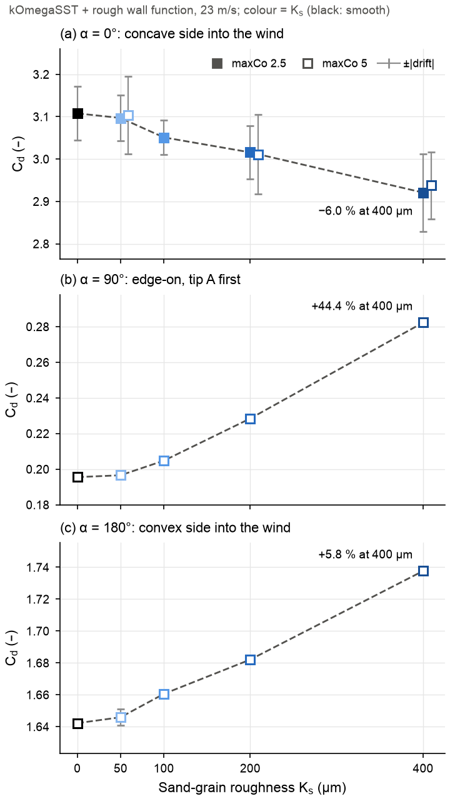

**How to read.**
- *Panels*: one per angle, each with its own y scale.
- *Colour*: Ks (black smooth, then light to dark blue for 50–400 µm).
- *Markers*: filled squares are maxCo 2.5; open squares are maxCo 5 (offset +9 µm at α 0).
- *Bars*: ±|drift|. At α 90 and 180 they are mostly smaller than the markers; at α 180 the Ks-50 bar
  (±0.0051) is visible.
- *Labels*: the change at 400 µm against Ks 0 of the same set.
- *Companion figure*: [fig/roughness_cl_vs_ks.png](fig/roughness_cl_vs_ks.png) shows mean Cl in the
  same layout.

**Findings** (computed):

| α | Cd, Ks 0 → 400 µm | Change at 100 / 200 / 400 µm | Resolved by the drift rule | Strength |
|---|---|---|---|---|
| 0 (maxCo 2.5) | 3.1078 → 2.9208 | −1.82 / −2.96 / −6.02 % | only 400 µm (1.21 × noise) | established for the trend |
| 90 (maxCo 5) | 0.1955 → 0.2823 | +4.72 / +16.84 / +44.40 % | all (noise ≤ 1e-4) | established within this model and time step |
| 180 (maxCo 5) | 1.6422 → 1.7377 | +1.12 / +2.43 / +5.81 % | from 100 µm (33–153 × noise) | established |

**α 0** (concave side into the wind).
- **Cd falls monotonically.** 99 % of the fall at 400 µm is pressure drag (dCd_pressure −0.1858,
  dCd_viscous −0.0011).
- **Why the trend is well supported** although only the 400-µm change passes the drift rule:
  - the order is monotonic over five levels (Spearman −1, exact permutation p = 0.017);
  - the maxCo-5 set reproduces it;
  - the scatter about a straight line (rms 0.0071) is 6–13 times smaller than each case's drift
    (0.041–0.092).
- **The drift rule is conservative here.** That the drift is mostly common to all cases is
  inferred.
- **Lift and frequency.** Mean Cl moves toward zero (−0.5766 → −0.4485, resolved at 200 and
  400 µm), and St rises 10.1 % (0.1089 → 0.1199).
- **The wake.** The oscillation barely changes (Cd_std −2.6 %, Cl_std −3.3 %), so "roughness weakens
  the wake" is uncertain.
- **State.** All 17 α-0 wall-function cases are in the high-drag state.

**α 180** (convex side into the wind).
- **Cd rises monotonically.** 89 % of the rise is pressure drag, and the viscous part more than
  doubles (0.0083 → 0.0187).
- **Lift and frequency.** |Cl| falls 6.4 % and St changes by −0.9 %.

**α 90** (edge-on). This is the largest relative effect: Cd +44.4 %, Cl +64.1 %, St −14.8 %. The
absolute Cd change (+0.087), however, is similar to that at α 180 (+0.095); the percentage is large
because the base drag is small. Two facts make these percentages model-dependent:
- **Wall treatment.** The smooth wall-function Cd (0.196) is 43–48 % below Stage 1's low-Re SST
  values (0.345 at maxCo 5, 0.375 at maxCo 2.5).
- **Time step.** The time-step sensitivity is untested at this angle, and Stage 1's α-90 runs lost
  their shedding when maxCo was halved.

**Physics** (inferred).
- **α 0.** The cup stagnates and the flow separates at the square tips, so roughness cannot move the
  separation points. The drag change is a pressure change in the wake.
- **α 180.** A rough turbulent layer has less momentum near the wall, so it separates earlier on the
  curved back and leaves a wider wake. Pressure drag rises, and friction rises too.

### 3.3 The drag difference D, and the measured gains

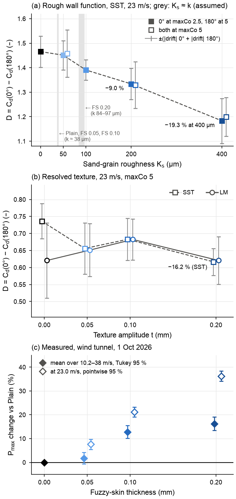

**How to read.**
- *(a)* D = Cd(0°) − Cd(180°) against Ks, wall functions, 23 m/s.
  - Filled squares: α 0 at maxCo 2.5 with α 180 at maxCo 5, because α 180 has no maxCo-2.5 run.
    Open squares: both angles at maxCo 5.
  - Grey bands: Ks ≈ k of the printed blades (assumed mapping).
  - Bars: ±(|drift| at 0° + |drift| at 180°). A label marks a resolved change.
- *(b)* D against the texture amplitude t, for SST (dashed, squares) and LM (solid, circles). The
  texture is the nominal slicer amplitude, whose Ra (0.397 t) is 2–8 times the measured Ra.
- *(c)* The measured peak-power change against Plain, by fuzzy-skin thickness.
  - Filled diamonds: the geometric mean over 10.2–38 m/s, with Tukey simultaneous 95 % intervals.
  - Open diamonds: the change at 23.0 m/s, with pointwise 95 % intervals.
- *Reading the directions*: D falls with roughness in (a), and for SST in (b), while measured power
  rises in (c).

**Finding** (computed; established for the sign of the wall-function change in these 2D fully
turbulent models, indicative for the texture; the link to power is inferred).
- **Wall functions.**
  - D is 1.4656 at Ks 0, then 1.4511, 1.3906, 1.3337 and 1.1831 (−0.99, −5.11, −9.00, −19.27 %).
  - The change is resolved at Ks 200 µm (1.04 × the noise, marginal) and at 400 µm (1.82 ×).
  - With both angles at maxCo 5, against Ks 50: −8.81 % (not resolved) and −17.69 % (resolved). The
    mixed set gives the same changes to within 0.010–0.011.
- **The sign does not depend on the uncertain α-0 effect.**
  - The α-180 rise alone lowers D by 0.018, 0.040 and 0.095 at Ks 100, 200 and 400 µm, each 33–153
    times its noise.
  - The α-0 fall supplies 66 % of the change at 400 µm, and it exists only in the high-drag state.
- **Texture, SST.** D is 0.7361 at t 0, then 0.6559, 0.6828 and 0.6167 (−10.91, −7.24, −16.23 %).
  It is resolved only at t 0.20 mm (0.1195 against noise 0.0913), and that fall comes from the α-180
  rise, which has no time-step check (§3.4).
- **Texture, LM.** +4.92, +9.94 and −0.01 %, none resolved. These are the only CFD changes with the
  sign of the measured gains.
- **Measured** (report):
  - geometric mean over 10.2–38 m/s, Tukey simultaneous 95 %: FS 0.05 +1.8 % [−0.6, +4.2] (not
    resolved), FS 0.10 +12.8 % [+10.1, +15.5], FS 0.20 +16.2 % [+13.5, +19.0];
  - at 23.0 m/s: +7.6, +21.2 and +36.2 % (pointwise 95 % ±2.1 %).

**What it means** (inferred, from the two-position model).
- **First sign conflict.** Every resolved roughness effect lowers the drive N for every λ from 0 to
  0.25. The fully turbulent 2D models therefore predict a loss where the rig measured a gain.
- **Second sign conflict.** In the model, roughness lowers λ0 from 0.158 (Ks 0) to 0.129
  (Ks 400 µm). The rig turned faster with fuzzy skin (measured):
  - the light-load λ at 23 m/s was 0.160 (Plain), 0.162, 0.168 and 0.181 (FS 0.05, 0.10, 0.20; the
    larger of the two runs);
  - the light-load rotor speed rose +1.5 % [+0.1, +2.9], +6.6 % [+5.1, +8.1] and +9.1 % [+7.6,
    +10.6] (geometric mean over 12.4–38 m/s, Tukey simultaneous 95 %).
- **Limits of the argument.** The two-position model is crude. The direct test is a rough-wall rotor
  case, which does not exist yet. The report also notes that the faster rotation could come from less
  resisting torque (mounting, balance) rather than from aerodynamics.

### 3.4 Resolved texture: SST against LM

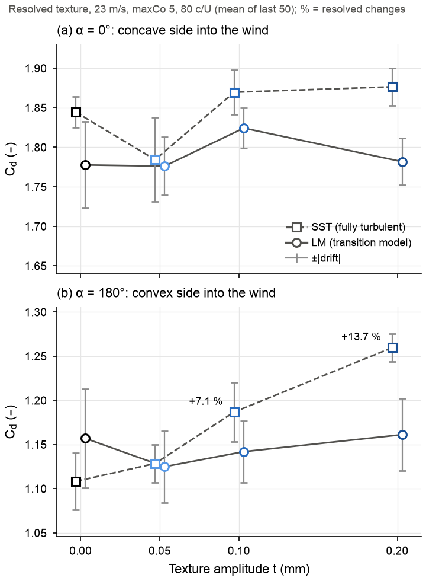

**How to read.**
- *Panels*: Cd against texture amplitude t at α 0 (a) and α 180 (b); 23 m/s, maxCo 5, 80 c/U
  averaged over the last 50.
- *Lines*: SST dashed with squares, LM solid with circles. Colour = t (black: the smooth reference
  mesh).
- *Bars*: ±|drift|. Percentages label only the changes resolved by the drift rule.

**Findings** (computed).
- **SST at α 180** (indicative at both amplitudes: resolved by the drift rule, but with no
  time-step check on a low-Re mesh at maxCo 5, the set-up that failed at α 180 in Stage 1; see the
  caveats below).
  - Cd goes from 1.1083 to 1.1285 (+1.83 %, not resolved), 1.1868 (+7.09 %, 1.19 × noise, marginal)
    and 1.2598 (+13.68 %, 3.15 ×).
  - At t 0.20 mm the pressure drag rises by 0.160 and the viscous drag falls by 0.008. Part of the
    wall force now acts as pressure on the bump faces (inferred).
- **LM at both angles, and SST at α 0** (unresolved).
  - No texture amplitude changes Cd by more than the drift rule; the changes span −3.25 % to
    +2.62 %.
  - For LM the noise is 4.5–8.4 % of Cd, and the largest change is 0.58 × its noise.
  - This bounds the LM texture effect. It does not show that the effect is zero.
- **SST against LM on the smooth (t 0) mesh** (unresolved).
  - Cd(α 0) differs by +0.0668 (noise 0.074) and Cd(α 180) by −0.0487 (noise 0.088), so D differs by
    +0.1155, i.e. +18.6 % (noise 0.162).
  - This is the only comparison with the sign the tripping idea needs: the fully turbulent layer
    gives a larger D than the transitional one. It is not resolved.
  - With texture (t ≥ 0.05 mm), D(SST) − D(LM) is within 0.005 of zero, also not resolved.
- **At t 0.20 mm**, SST is above LM at both angles by a resolved amount: +0.0947 at α 0 and +0.0987
  at α 180.

**Caveats.**
- **Sampling.** Each case is a single realisation of one random pattern, averaged over 50 c/U, and
  all 16 are still drifting downward (−0.016 to −0.056).
- **Mesh.** The t 0.20 mm mesh passes checkMesh only under a relaxed rule (maximum skewness 4.48).
- **Texture shape.** The texture is the nominal slicer displacement, meshed as 2D spanwise ridges.
  Ridges trip a laminar layer at a lower Re_k than the printed 3D texture (meeting notes), so these
  runs overstate tripping.
- **Model scope.** LM's response to geometric ridges is outside its calibration.
- **Different states.** The α-180 texture runs shed weakly and irregularly (St peak share
  0.05–0.57), unlike the wall-function runs (0.96), so the two families are in different flow states.
- **Time step at α 180** (computed from `dt_mean_s`; recomputed by `src/team_summary_check.py`).
  - The α-180 texture runs stepped at 1.50–1.57 µs, about 0.6 times the α-0 texture runs
    (2.38–2.70 µs).
  - In the healthy Stage 1 pairs, the α-180 time step is 0.97–1.26 times the α-0 one, so they show
    no such drop. In Stage 1, every medium-mesh α-180 run at maxCo 5 was flagged (§2.2).
  - The α-180 texture runs show none of the Stage 1 symptoms: no negative drag, Cd_std at most 3 % of
    Cd, and a maximum y+ of at most 0.83. They are therefore not flagged, but a maxCo-2.5 repeat of one
    of them should confirm them (§8.4).

**Roughness Reynolds number** (computed). Re_k = U t/ν at 23 m/s, an upper bound with u_k = U and
k = t, is 76, 152 and 303 for t 0.05, 0.10 and 0.20 mm. Taking the peak-to-valley height 2t doubles
these values. Transition onset for 2D roughness is about Re_k 40–260 (literature, via the meeting
notes and SAND2017-11288).

### 3.5 Wind speed and Ks+

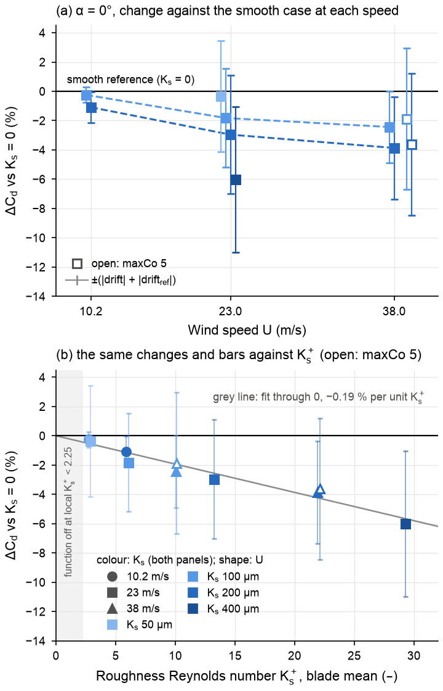

**How to read.**
- *(a)* The change in α-0 Cd against the smooth case at the same speed and maxCo, plotted against
  wind speed, one colour per Ks.
  - Bars: ±(|drift| + |drift_ref|), as % of the reference Cd. A bar that crosses zero means the
    change is not resolved.
- *(b)* The same changes and bars against the blade-mean Ks+.
  - Marker shape = speed; open markers = maxCo 5.
  - The grey line is a fit through zero.
  - The grey band is where the model's roughness function is off (local Ks+ < 2.25).
- *Mesh*: the 10.2 m/s cases use their own mesh (first cell 1.30 mm), so compare changes, not
  absolute values.

**Finding** (computed; established as a property of the model; the individual points are
indicative).
- **The effect grows with speed.** At a fixed Ks, the drag fall grows with speed:
  - Ks 100 µm: −0.25 / −1.82 / −2.44 % at 10.2 / 23 / 38 m/s;
  - Ks 200 µm: −1.09 / −2.96 / −3.87 %.
- **One line in Ks+.** The ten changes lie near one line: −0.193 ± 0.009 % per unit Ks+ (residual
  rms 0.40 percentage points). Only 3 of the 10 pass the drift rule.
- **What the line means.** The wall function's log-law shift depends only on Ks+, so the line shows
  the model working as built; it is not a physical finding.
- **No onset or plateau** within blade-mean Ks+ 2.75–29.3.

**What it means.** In this model the roughness effect is largest at 38 m/s and grows smoothly. The
measured gains peaked at 21–25 m/s and shrank above 27 m/s (measured), a pattern this model cannot
produce (inferred).

### 3.6 Is the wall-function model valid here, and what Ks do the printed blades have?

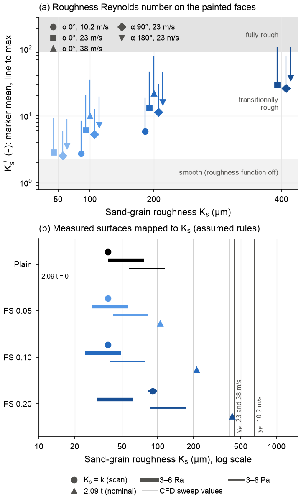

**How to read.**
- *(a)* Ks+ on the painted faces against Ks. The marker is the blade mean; the line runs to the
  maximum (log scale).
  - Bands: smooth (roughness function off, Ks+ < 2.25), transitionally rough, and fully rough
    (> 90).
  - The five maxCo-5 α-0 repeats are not plotted; their Ks+ is within 0.21 of the plotted points.
- *(b)* Where Plain, FS 0.05, FS 0.10 and FS 0.20 fall on the Ks axis under four assumed rules:
  Ks = k (scan height); 3–6 Ra; 3–6 Pa; 2.09 t (nominal texture).
  - Grey verticals: the CFD's Ks values.
  - Dark verticals: the height y_P of the first-cell centre. The rough wall function is valid only to
    their left.

**Validity** (computed; established).
- **Geometric limit met.** The first-cell centre is above Ks in every case (Ks/y_P 0.11–0.91; 0.91
  at Ks 400 µm is marginal).
- **Mostly transitionally rough.**
  - Blade-mean Ks+ is 2.55–3.55 at 50 µm, near the smooth limit.
  - It is transitionally rough at 100–400 µm, up to 37.4.
  - Local maxima exceed 90 only in three Ks-400 cases (maximum 106.2).
- **Buffer layer.** Blade-mean y+ of 17.2–48.6 puts much of the wall in the buffer layer, below the
  log layer that a wall function assumes.
- **Consequence.** The wall-function results give the sign and rough size of a turbulent rough-wall
  effect, not a resolved boundary layer.

**Mapping the scans to Ks** (the rules are assumed; D is computed by interpolation; indicative).
- **No rule reproduces the measured order** (FS 0.20 > FS 0.10 > FS 0.05, with FS 0.05 not resolved
  from Plain).
- **Ks = k.** Plain, FS 0.05 and FS 0.10 all get about 38 µm, so the model cannot separate them,
  although FS 0.10 measured +12.8 %.
- **3–6 Ra.** Plain (Ra 12.7 µm) is the roughest surface.
- **Largest gain.** The largest D gain against Plain under any rule is +2.3 % at the range midpoints
  (+2.7 % for any common multiplier from 3 to 6). All of these are below the noise of D, which is
  7–11 % of D.
- **Nominal texture** (Ks = 2.09 t: 104, 211 and 422 µm). D falls by 5.3, 9.6 and 19.3 %.

### 3.7 The α-0 flow states across both tables

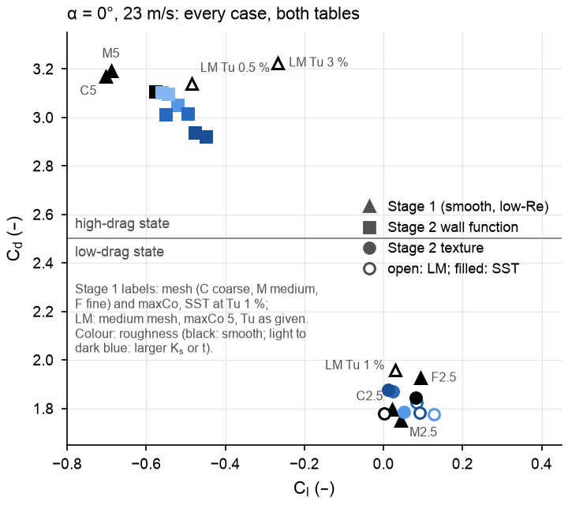

**How to read.**
- *Axes*: Cd against Cl for every α-0 case at 23 m/s in both tables.
- *Shapes*: triangles are Stage 1 smooth low-Re runs (labels: mesh C/M/F and maxCo for SST, Tu for
  LM); squares are Stage 2 wall-function runs; circles are Stage 2 texture runs.
- *Fill and colour*: filled = SST, open = LM; colour = roughness (black = smooth).
- *Line*: Cd 2.5 separates the two states.

**Finding** (computed; established).
- **Wall-function family.** All 17 α-0 wall-function cases are in the high-drag state (Cd
  2.921–3.146, Cl −0.654 to −0.448).
- **Texture family.** All 8 α-0 texture cases are in the low-drag state (Cd 1.776–1.877, Cl +0.001
  to +0.128).
- **Stage 1.** The smooth Stage 1 runs land in either state on the same mesh.
- **Mesh and numerics.** At maxCo 5, SST is in the low-drag state on the smooth texture mesh (1.844)
  and in the high-drag state on the Stage 1 medium mesh (3.191). The state therefore depends on mesh
  and numerics as well as on maxCo and Tu (inferred; the two runs also differ in machine and run
  length).
- **Size.** The same-mesh gap between the states (Stage 1 medium SST, maxCo 5 against 2.5) is 1.44,
  7.7 times the largest roughness change (0.187).
- **No switch seen.** No run shows roughness switching the state. Whether the 80 c/U texture runs
  would stay in the low-drag state over 150 c/U is unknown.

**What it means.** A roughness-induced switch between states would change the section drag far more
than any roughness effect within one state. None was seen, but LM at α 0 was run only at 23 m/s.

### 3.8 How large a section change would explain the measurement?

(inferred from the two-position model; indicative for the leverage, uncertain for the size)

**Leverage.** The drive N is a small difference of two large terms, so small section changes have
large leverage. At λ 0.125 (the measured peak-power λ is 0.122–0.131), each gain needs one of two
changes:

| Measured gain | Cd(α 0) alone | or Cd(α 180) alone |
|---|---|---|
| +12.8 % (FS 0.10) | +1.62 to +1.76 % | −1.85 to −2.04 % |
| +16.2 % (FS 0.20) | +2.05 to +2.23 % | −2.35 to −2.59 % |
| +36.2 % (FS 0.20 at 23 m/s) | +4.58 to +4.98 % | −5.25 to −5.78 % |

The two ends of each range come from the CFD's high-drag values (wall functions, Ks 0) and from the
shell values.

**The leverage depends on the flow state.**
- **Low-drag values.** With them, N(0.125) is +0.0095 (SST texture) or −0.103 (LM texture): almost
  no drive, or a negative drive, at the measured λ.
- **λ0 is too low.** The model's λ0 (0.107–0.158) is at or below the rig's light-load λ (0.160–0.181
  at 23 m/s, 0.207–0.239 at 38 m/s), so the model misses part of the torque.

**Resolution available** (computed, the drift-rule noise as % of Cd):
- α-180 wall-function runs: 0.03–0.33 %;
- α-0 wall-function runs: 3.4–5.0 %;
- texture runs: 2.3–8.4 %.

A roughness effect too small to resolve in the current α-0 and texture runs could therefore still
explain the measurement.

### 3.9 What Stage 2 means for the tunnel results

- **No support for turbulent-wall roughness.** The CFD gives no support to the idea that fuzzy skin
  raises power through turbulent-wall roughness: every resolved effect has the wrong sign (the sign
  is computed; the link to power is inferred).
- **The tripping idea is not tested** (unresolved).
  - LM texture runs exist only at 23 m/s, and their noise exceeds the change of about 2 % that would
    be needed.
  - Stage 1 has no healthy LM run at α 75–255°.
- **The meeting's prediction cannot be tested with these cases.** The prediction is that the onset
  of the gain moves to lower speed as roughness grows. The wall functions contain no transition, and
  the LM texture runs exist only at 23 m/s.
- **The measured data are consistent with the predicted order** (measured):
  - steepest power rise at 24–26 m/s (Plain, the two runs), 22–24 (FS 0.05, overlapping Plain),
    22 (FS 0.10) and 20 m/s (FS 0.20), at set points 2.1 m/s apart;
  - largest gain: FS 0.10 +22.4 % at 25.2 m/s, FS 0.20 +36.2 % at 23.0 m/s;
  - gains above 27 m/s: +1.2 to +3.8 % (FS 0.05), +11.9 to +17.4 % (FS 0.10), +12.7 to +23.7 %
    (FS 0.20).
- **Consistent, but it does not establish the mechanism.** Each level is one print, mounted once and
  run in order of thickness, and Plain was printed with coarser layers (report). The steepest-rise
  speed also never rose with run order: 26.2 and 24.1 m/s for the two Plain runs an hour apart, then
  24.1, 22.0, 22.0, 22.0, 19.8 and 19.8 m/s (`build/derived/run_summary.csv`). A one-step shift is
  therefore within the Plain repeat. The 7 Oct prediction was written after these data were taken.
- **FS 0.40 and FS 0.80 cannot be represented** by either Stage 2 method as built (ROUGHNESS_KS.md):
  - the texture mesher fails at t ≥ 0.4 mm;
  - the nominal Ks (835 µm and 1.68 mm) exceeds the wall-function first-cell height.
- **Open alternatives** for the measured gains (none tested):
  - transition on the real 3D blade;
  - 3D or rotating-flow effects;
  - a change of wake state;
  - non-aerodynamic causes: print, mounting, run order, layer height.

---

## 4. Stage 3: the 2D rotor (56 cases)

### 4.1 What was run, and why

**The assembly is unknown.** The rotor assembly has not been measured
([MEASUREMENTS_NEEDED.md §1](../../MEASUREMENTS_NEEDED.md)), so two hypotheses inferred from the CAD
were run (bolts radial, chord at 84° to the radius, R = 101.6 mm; assumed):
- **A**: arm on the concave face. The cups open toward the shaft, and the blade spans r 84.5–106.4 mm.
- **B**: arm on the convex face. The cups open outward, and the blade spans r 99.7–125.8 mm.

**The runs.**
- **Static** (16 cases). The rotor is frozen at 8 azimuths, θ 0–105° (one 120° period), for A and B
  at 23 m/s. The θ-mean static torque is the starting torque, and its sign gives the starting
  direction.
- **Rotating** (40 cases). Prescribed rotation at λ 0.05–0.30: A at 10.2, 23 and 38 m/s, and B at
  23 m/s.
  - Each case ran in both rotation senses, because the drag rule rests on a 7.4° angle and the
    impulsive-start smoke tests opposed it.
  - Two repeats at maxCo 2 check A at λ 0.15 in both senses.
- **Common to all.** SST with wall functions (y+ about 20–30), medium mesh, maxCo 4, Tu 1 %.
  - No rotor case uses the transition model, so this stage is the fully turbulent ("tripped")
    limit.
  - [LEARNING_LOG §10](../../docs/LEARNING_LOG.md#10-rotating-meshes-with-ami) explains the rotating
    mesh.

**How the rig is compared.** The comparison uses λ landmarks and curve shapes, not power levels:
- the rig's C_P is electrical, after generator and bearing losses;
- the CFD's C_P is 2D aerodynamic, without tips, arms or hub.

### 4.2 Static torque: which way does the rotor start?

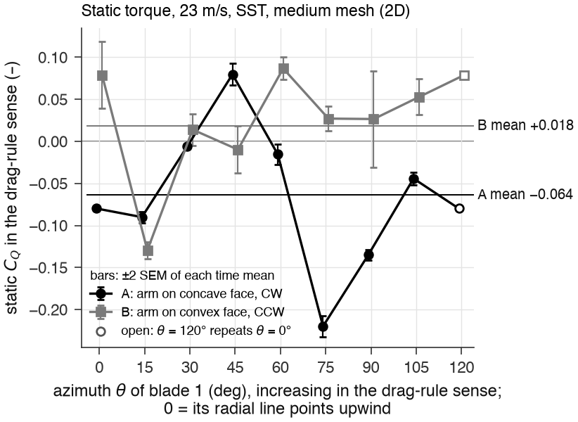

**How to read.**
- *Axes*: static C_Q against the azimuth θ of blade 1, each hypothesis in its own drag-rule sense
  (A CW, B CCW).
  - θ increases in that sense, so equal θ for A and B are mirror-image positions.
  - Positive means the wind pushes the frozen rotor in its drag-rule sense.
- *Symbols*: black circles are A, grey squares B.
  - Bars: ±2 SEM of each time mean.
  - The open marker at 120° repeats 0°.
- *Thin lines*: the θ-means.

**Hypothesis A** (computed; established within the 2D model; the geometry is inferred).
- **The mean.** The θ-mean is −0.0639 in the drag-rule sense, i.e. +0.0639 in the reversed sense
  (CCW). It is 41 SEM from zero by time averaging alone, and both interleaved 30° subsets agree
  (−0.0591, −0.0687).
- **The azimuths.** At 7 of 8 azimuths the wind pushes CCW, each resolved at 2 SEM.
- **The starting direction.** In 2D, an A rotor starts in the reversed sense, with the curled end
  (tip B) leading (inferred from the layout).
- **One exception.** A rotor parked at θ 45° (75° counted CCW) is pushed the other way, CW (C_Q
  +0.080 in the drag-rule sense). Its unsteady standard deviation there (0.123) is larger than that
  torque.

**Hypothesis B** (unresolved).
- **The mean.** The θ-mean is +0.0183 (CCW), 3.5 SEM from zero by time averaging alone.
- **The subsets disagree.** The interleaved subsets give +0.0515 and −0.0149, so the starting
  direction depends on which azimuths are sampled.
- **Unsteadiness.** B's static torque fluctuates 2.3 times as much as A's.

**Machines.** Some static runs ran on the Mac and the rest on Unity:
- A: θ 0, 30 and 60 on the Mac;
- B: θ 0 and 60 on the Mac, and θ 30 migrated.

A's subsets agree, so no platform effect is indicated.

**A check on the rig.** If the arms are on the concave face (A), the rotor should turn with the
curled end leading. A 20-s slow-motion video at a fan speed of 500 rpm tests this
(MEASUREMENTS_NEEDED.md §1, items 1–4 and 10).

### 4.3 Torque and power against λ at 23 m/s

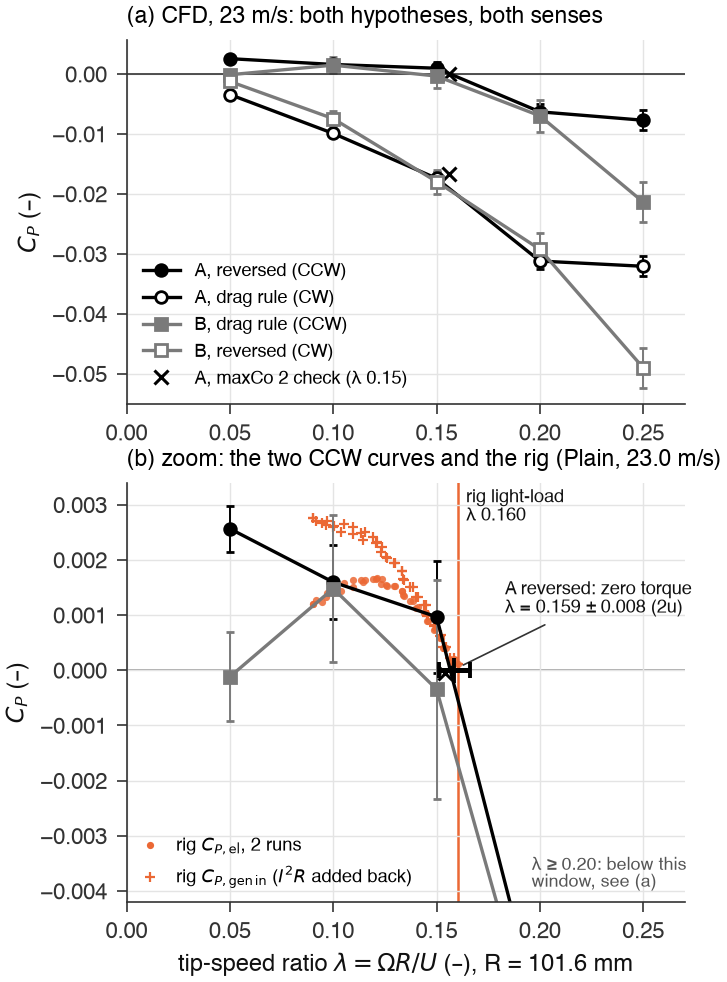

**How to read.**
- *(a)* C_P against λ at 23 m/s for all four hypothesis/sense combinations.
  - A is black circles, B grey squares; filled = CCW, open = CW in the model frame.
  - Bars: ±2u. The × is the maxCo-2 repeat at λ 0.15.
- *(b)* A zoom on the two power-producing curves (both CCW), with the rig's data at 23.0 m/s.
  - Orange dots: the rig's Plain C_P,el (2 runs).
  - Orange +: the rig's C_P,gen-in, which adds back the generator's I²R loss but not bearing
    friction.
  - Orange vertical: the rig's light-load λ, 0.160.
  - Black bar: the zero-torque λ of A reversed (0.159 ± 0.008).
- *Reading*: compare signs and λ locations, not heights.

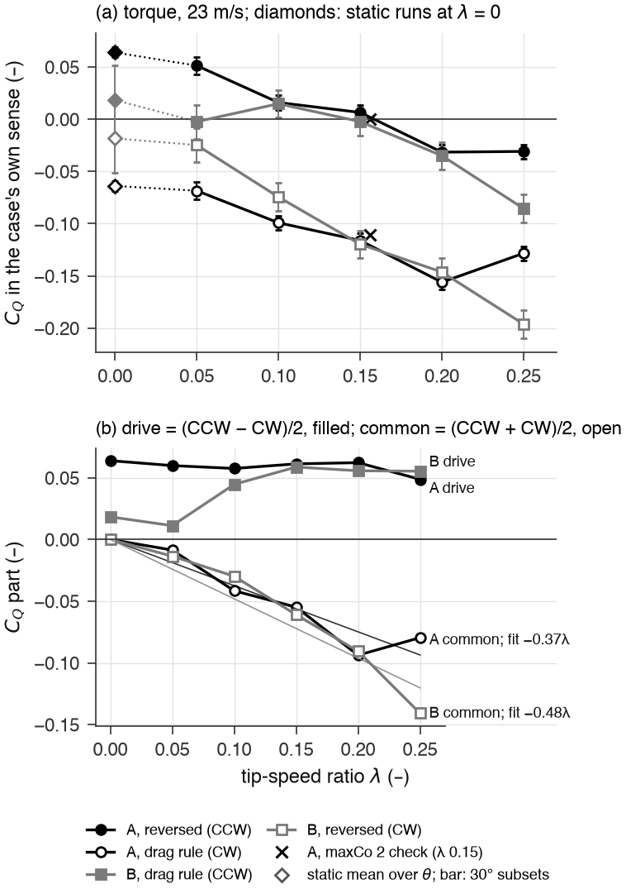

**How to read.**
- *(a)* C_Q against λ, with the same symbols. The diamonds at λ = 0 are the θ-mean static C_Q; their
  bars are the half-difference of the two 30° subsets.
- *(b)* Two parts of the torque, with fits through the origin:
  - the drive, (C_Q,CCW − C_Q,CW)/2 (filled);
  - the common part, (C_Q,CCW + C_Q,CW)/2 (open).
- *Scope*: the reading "drive ≈ starting torque, loss ∝ λ" holds for A only.

**Torque at 23 m/s** (computed; C_Q ± 2u):

| λ | 0.05 | 0.10 | 0.15 | 0.20 | 0.25 |
|---|---|---|---|---|---|
| A reversed (CCW) | +0.0513 ± 0.0083 | +0.0160 ± 0.0068 | +0.0065 ± 0.0068 | −0.0315 ± 0.0068 | −0.0308 ± 0.0068 |
| A drag rule (CW) | −0.0685 ± 0.0083 | −0.0991 ± 0.0068 | −0.1161 ± 0.0068 | −0.1560 ± 0.0068 | −0.1283 ± 0.0068 |
| B drag rule (CCW) | −0.0023 ± 0.0162 | +0.0148 ± 0.0132 | −0.0023 ± 0.0132 | −0.0349 ± 0.0132 | −0.0855 ± 0.0132 |
| B reversed (CW) | −0.0247 ± 0.0162 | −0.0745 ± 0.0132 | −0.1197 ± 0.0132 | −0.1463 ± 0.0132 | −0.1961 ± 0.0132 |

**The sign pattern** (established for averaging and time-step noise; one mesh, 2D, geometry
inferred).
- **A reversed.** It is the only combination with positive torque continuously from rest (static
  +0.064) through λ 0.05 (12.4u) and λ 0.10 (4.7u). At λ 0.15, +0.0065 ± 0.0068 is not resolved.
- **A drag rule and B reversed.** They absorb power at all 10 points (|C_Q| ≥ 3.0u).
- **B drag rule.** It is indistinguishable from zero at λ 0.05 and 0.15, and marginally positive at
  λ 0.10 (2.2u). B is not excluded, but it is not supported.

**Zero torque** (indicative).
- **The CFD value.** A reversed crosses zero at λ 0.1585 ± 0.0076. A linear fit gives 0.155, and
  using the maxCo-2 value at λ 0.15 gives 0.149 ± 0.020.
- **The rig.** Its light-load λ at 23.03 m/s is 0.1602 and 0.1582 (runs 1 and 2), a lower bound on
  its aerodynamic zero-torque λ. The generator torque at the lightest load alone (C_Q 0.0007) raises
  that bound to about 0.162 at the CFD's slope (inferred).
- **Verdict.** The CFD sits at the bound, with no margin.

**The power peak** (not determined against the rig).
- **The CFD.** C_P(0.05) exceeds C_P(0.10) by 0.00097 ± 0.00080, so the CFD's peak lies below
  λ 0.10. If the static mean is taken as the λ → 0 limit, the peak is near λ 0.067 at C_P 0.0028
  (inferred).
- **The rig.** C_P,el peaks at λ 0.1202 and 0.1219. C_P,gen-in, however, is highest at the lowest
  loaded λ (0.090).
- **The gap.** Adding back I²R moves the rig's peak down by at least 0.03 of the 0.053 gap. Bearing
  friction moves the aerodynamic peak back up by an unknown amount.

**Torque structure** (computed; the reading is inferred; indicative for A).
- **Continuity.** At λ 0.05 every hypothesis and sense lies 0.0046–0.0207 below its static θ-mean.
- **The drive (A).** It stays within 0.0016–0.0063 of the static 0.0639 up to λ 0.20, and is
  0.0151 below it at λ 0.25.
- **The common part (A).** It falls roughly as −0.37λ (fit residual rms 0.0116), so for A,
  C_Q ≈ 0.06 − 0.37λ in the reversed sense.
- **B.** The reading fails: its drive rises from 0.011 to 0.059.

**Physics.**
- **Push and brake.** A drag rotor's torque is the push on the blade moving with the wind minus the
  drag on the blade returning against it.
- **The drive.** Spinning the rotor the other way swaps the two roles. Half the difference between
  the two senses therefore isolates the direction-dependent drive, which equals the starting torque
  at λ = 0.
- **The brake.** Half the sum is a brake that grows with λ: the faster the rotor turns, the less wind
  the advancing blade feels and the more headwind the returning blade meets.

### 4.4 Wind speed: the CFD's zero-torque λ does not follow the rig

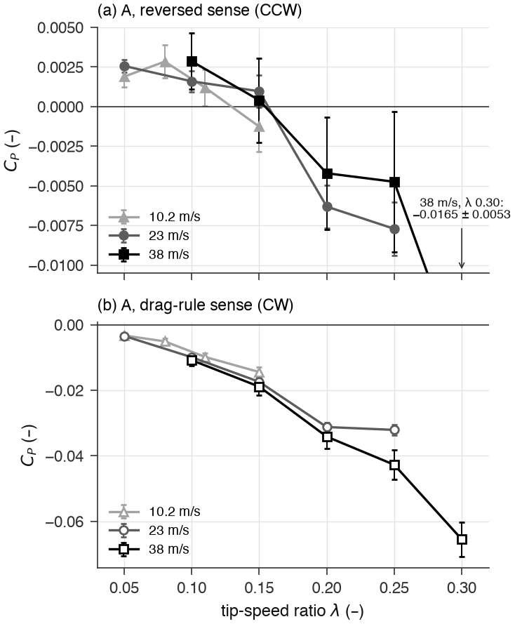

**How to read.**
- *Curves*: C_P against λ for A at 10.2 m/s (light grey triangles), 23 m/s (grey circles) and
  38 m/s (black squares).
- *Panels*: (a) the reversed sense; (b) the drag-rule sense.
- *Bars*: ±2u. The 38 m/s, λ 0.30 point of (a) is off scale (−0.0165 ± 0.0053).

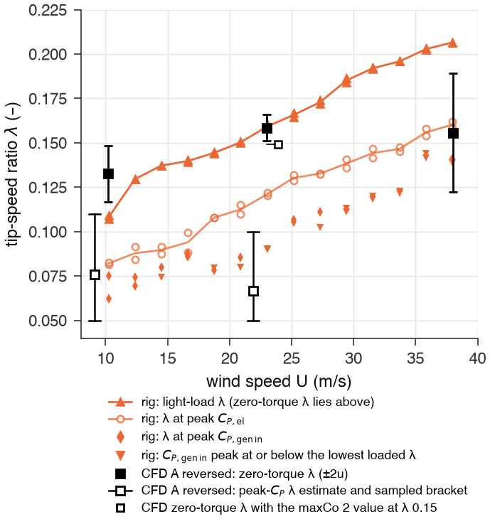

**How to read.**
- *Orange (rig, Plain, both runs)*:
  - ▲ light-load λ; the aerodynamic zero-torque λ lies above it;
  - ○ λ at peak C_P,el;
  - ♦ λ at peak C_P,gen-in, or ▼ where that peak sits at the lowest loaded λ.
- *Black (CFD, A reversed)*:
  - ■ zero-torque λ ± 2u;
  - □ with a bar: the peak-C_P λ estimate and its sampled bracket, drawn 1.1 m/s left of its speed;
  - small □: the zero-torque λ with the maxCo-2 value.
- *Reading*: each black square should sit at or above the orange triangles at the same speed.

**Findings** (computed; indicative: a one-sided bound, with blockage and wind calibration not
measured).
- **Power only at low λ.** A reversed delivers power only up to λ ≈ 0.15 at all three speeds.
  - The highest computed C_P is 0.00284 (10.2 m/s, λ 0.08), 0.00257 (23 m/s, λ 0.05) and 0.00286
    (38 m/s, λ 0.10).
  - At 23 and 38 m/s the highest value is at the lowest λ run, so the peak is not located there.
  - In the drag-rule sense, power is absorbed at every λ and speed (|C_Q| ≥ 9.8u).
- **Zero-torque λ against the rig's light-load λ:**

  | Wind speed | CFD zero-torque λ (± 2u) | Rig light-load λ (runs 1 / 2) | CFD relative to the rig |
  |---|---|---|---|
  | 10.2 m/s | 0.133 ± 0.016 | 0.107 / 0.109 | above the bound |
  | 23 m/s | 0.159 ± 0.008 | 0.160 / 0.158 | at the bound |
  | 38 m/s | 0.156 ± 0.033 | 0.2065 / 0.2065 | 0.051 below the bound (3.1u) |

- **At 38 m/s** the CFD torque is already negative at λ 0.20 (−0.021 ± 0.018) and 0.25, while the rig
  still delivers power at λ 0.20–0.2065.
- **The trends differ.** The rig's landmarks roughly double from 10.2 to 38 m/s: λ at peak C_P,el
  goes from 0.081–0.083 to 0.159–0.162. The CFD's zero-torque λ goes 0.133 → 0.159 → 0.156.
  - The 10.2 − 23 m/s difference (−0.026 ± 0.017) is resolved. The meshes differ, however (first
    cell 1.5 mm, capped, at 10.2 m/s against 0.87 mm at 23 m/s), so it cannot be attributed to the
    Reynolds number.
  - 23 and 38 m/s do not differ resolvably (0.003 ± 0.034).

**What it means** (inferred). The 2D, fully turbulent rotor model does not reproduce the rig's
operation at high wind speed.
- **Untested candidate causes:**
  - a Reynolds-number dependence that fully turbulent SST cannot show (relevant to the transition
    idea);
  - the wrong assembly;
  - blockage, or the wind-speed calibration.
- **Not friction.** Friction can only lower the rig's λ, so it cannot explain the rig running above
  the CFD's zero-torque λ.

### 4.5 Power levels (indicative)

**The ratios** (computed). At matched λ, A reversed's C_P divided by the rig's C_P,gen-in (a lower
bound on the rig's aerodynamic C_P) is:
- 1.76 (λ 0.05) and 2.24 (λ 0.08) at 10.2 m/s;
- 0.61 (λ 0.10) and 1.30 (λ 0.15) at 23 m/s;
- 0.10 (λ 0.15) and negative (λ 0.20) at 38 m/s.

**Below the bound.** The CFD lies below that bound by 3.0u at 23 m/s, λ 0.10, and by 2.9u and 2.8u
at 38 m/s, λ 0.15 and 0.20.
- **The expectation.** A 2D model without tip, arm or end losses should sit above the 3D rig.
- **The inference.** At 23–38 m/s the model therefore underpredicts the rig (inferred).

**Why levels are not quoted.** Several unquantified effects pull in opposite directions:
- 2D has no tips or arms, which raises the CFD's C_P;
- 2D URANS overstates coherent shedding, with an uncertain effect on C_P;
- generator and bearing losses lower the rig's C_P,el;
- blockage raises the rig's coefficient at the nominal speed.

Absolute power should therefore not be quoted against the rig.

**The rig's rise with speed** (inferred). The rig's C_P,el peak grows 2.4 times from 10.2 to
38 m/s (0.00092–0.00094 → 0.00224–0.00229). A constant friction torque weighs (38/10.2)² ≈ 13.9
times more in C_Q at 10.2 m/s than at 38 m/s, so part of that rise may be friction.

### 4.6 Can the rotor CFD resolve a roughness effect?

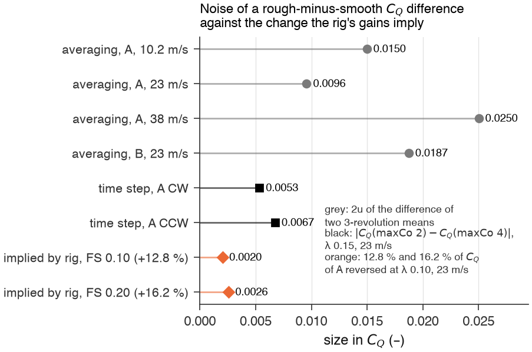

**How to read.** A comparison is resolvable only when the orange bars are longer than the grey and
black ones.
- *Grey*: the averaging noise 2u of the difference of two 3-revolution means (a rough-minus-smooth
  comparison), for each hypothesis and speed.
- *Black*: |C_Q(maxCo 2) − C_Q(maxCo 4)| at λ 0.15, 23 m/s.
- *Orange*: the C_Q change implied by the rig's gains, i.e. 12.8 % and 16.2 % of A reversed's C_Q at
  λ 0.10, 23 m/s.

**Finding** (computed noise sizes, established; the implied change is an order-of-magnitude
estimate, assumed).
- **The implied change** is 0.0020 (FS 0.10) and 0.0026 (FS 0.20).
- **Against the noise.** For A at 23 m/s it is:
  - 3.7–4.7 times smaller than the averaging noise of a difference (0.0096);
  - 2.1–3.3 times smaller than the time-step change (0.0053–0.0067).
  - Over all rows it is 2.1–12.2 times smaller.
- **What resolution would take.** Resolving it at 2u needs about 66 (FS 0.10) or 42 (FS 0.20)
  averaged revolutions per run, against 3 now. With 3 start-up revolutions, that is about 17–20 h
  (66) or 11–13 h (42) per run on 8 ranks (estimated from 875–1,028 s per revolution at λ 0.10). The
  time-step and mesh errors must also cancel between the rough and smooth runs.

**Pressure dominates the torque** (computed).
- **Viscous torque.** The net viscous C_Q is at most 0.0026 in any rotor case and at most 0.0006
  for A reversed.
- **The swing.** At λ 0.10, the instantaneous torque of A reversed swings from −0.449 to +0.370
  around a mean of +0.016.
- **Consequence** (inferred). A roughness effect of the rig's size must act through separation and
  the wake (pressure), not through skin friction.

### 4.7 What Stage 3 means for the tunnel results

- **Which configuration to use.** Use A reversed (curled tip leading) for further rotor CFD until
  the assembly is measured. The slow-motion video tests it directly.
- **Agreement at one speed only.** The zero-torque λ agrees with the rig at 23 m/s. The rig's rise
  of λ with wind speed is missing from the 2D fully turbulent model. The meeting's prediction
  concerns how the gains change with wind speed, so this set-up cannot yet explain or predict that
  trend.
- **What a rough-blade comparison needs.**
  - About 42–66 averaged revolutions per run, the same mesh and maxCo, and λ 0.10–0.12.
  - Ideally the transition model, but LM on the low-Re rotor mesh needs about 13 times more steps
    at 1.6–1.8 times the cost per step (2-rank smoke tests, rotor2d README): roughly 10–20 days per
    case on 8 ranks, from the 11–20 h of a wall-function run of that length (estimated).
  - Without these, a null result says nothing.
- **The fully turbulent limit.** No rotor case uses the transition model, so this stage is the
  fully turbulent limit. Its smooth-wall result may correspond more closely to the boundary-layer
  state of the FS rotors than to a transitional Plain rotor (inferred).

---

## 5. Numerical quality

| Check | Stage 1: section | Stage 2: roughness | Stage 3: rotor |
|---|---|---|---|
| Solver health | 23 of 51 flagged (medium, maxCo 5); 28 healthy | none of the 43 shows a Stage 1 corruption symptom (computed; recomputed by `src/team_summary_check.py`), but the α-180 texture runs take time steps about 0.6 times as long as the α-0 ones (§3.4); the 8 maxCo-5 divergences were re-run at maxCo 2.5 | 56 of 56 finished; AMI weights 1–1.00002 |
| Time step | maxCo 5 → 2.5 (also Mac → Unity, except α 180 medium): the α-0 state switches (−43 to −45 %), α-90 shedding stops, α 180 −4.6 %; α 180 medium flagged at maxCo 5 and healthy at 2.5 (both Unity); maxCo 2.5 itself untested | wall function, α 0: −0.15 to +1.24 % (none resolved); the roughness effect changes by 0.007–0.017 (6–22 % of it); α 90 and 180 and the texture runs untested | maxCo 4 → 2 at λ 0.15: ΔC_Q +0.0053 and −0.0067 (1.1u and 1.4u, not resolved); moves the zero-torque λ to 0.149 ± 0.020 |
| Grid | coarse/medium/fine at maxCo 2.5: only α 90 converges monotonically (Cd: p 1.64, GCI 7.6 %); α 0 and 180 oscillate (9.0 %, 11.5 %) | none (one mesh per family) | none (medium only); a 10 % mesh effect would be 0.005–0.01 in C_Q and 0.012–0.024 in the zero-torque λ (inferred) |
| Averaging | 100 c/U windows complete; 19 of 24 unsteady healthy runs drift within 2 standard errors; α 15 LM not stationary | windows of 100 c/U (wall functions) and 50 c/U (texture); every α-0 wall-function run and every texture run drifts downward; α 90 and 180 wall-function runs: absolute drift ≤ 0.0051 | 2–3 revolutions averaged; σ_rev 0.0059 (A, 23 m/s), 0.0092 (A, 10.2 m/s), 0.0153 (A, 38 m/s), 0.0115 (B, 23 m/s) |
| Near-wall | low-Re; healthy time-mean maximum y+ 0.56–1.68 (at the corners) | wall functions: blade-mean y+ 17.2–48.6, Ks/y_P ≤ 0.91; texture: y+ mean 0.047–0.133, maximum 1.04 | wall functions: y+ mean 20.4–29.3, maximum 68.1–111.6 |
| Free stream and ω | probe Tu within +0.12 to +3.0 % (relative) of each target; ω bounded in 0 steps | probe Tu 1.001–1.015 %; ω bounded in 0 steps | probe Tu 1.00004–1.00018 %; ω bounded in 0 steps |
| Machines | the maxCo 5/2.5 pairs at 23 m/s are also Mac/Unity pairs | α 180 Ks 0 ran on the Mac; Ks 50 was migrated inside its averaging window (its drift is 6–40 times the others' in size) | static runs partly on the Mac |

How to read these checks:

- **Time step.** Halving maxCo should change nothing that matters
  ([LEARNING_LOG §5](../../docs/LEARNING_LOG.md#5-courant-number-and-time-step)).
  - On the low-Re section meshes, going from maxCo 5 to 2.5 changed the flow state at α 0 and
    removed the shedding at α 90 (with a change of machine, §2.4), and it turned the flagged α-180
    medium run into a healthy one (same machine). maxCo 2.5 is the minimum for further low-Re work,
    and a maxCo-1.25 check is still owed.
  - On the wall-function meshes at α 0, the time step mattered little (≤ 1.24 % in Cd).
  - The rotor check is within its noise.
- **Grid.** Refining should make the results settle; a GCI exists only when three meshes approach
  a limit monotonically
  ([LEARNING_LOG §8](../../docs/LEARNING_LOG.md#8-mesh-independence-and-the-gci)).
  - Only the steady α-90 case does this.
  - At α 0 and 180, the spreads of 9.0 % and 11.5 % set the smallest difference that a comparison
    across meshes can resolve.
- **Averaging.** A mean is trustworthy when the run has forgotten its start (small drift) and the
  window holds enough cycles
  ([LEARNING_LOG §6](../../docs/LEARNING_LOG.md#6-convergence-and-averaging-windows)).
  - The texture runs and the rotor runs (2–3 revolutions) are the shortest. The texture windows hold
    7–9 shedding cycles, except three α-180 runs whose main peak is a slow oscillation at St about
    0.03 (about 1.5 cycles).
  - Their noise, not their physics, limits what they can resolve.
- **Machines and restarts.** Comparisons are fair only within one set-up. The Mac/Unity confound
  at 23 m/s is real, but the Unity maxCo-5 runs at 10.2 and 38 m/s point to the time step, not the
  machine (inferred).

---

## 6. Limits of 2D URANS and of these models

1. **2D shedding.** 2D forces every vortex to be coherent along the span, which overstates the
   fluctuating forces and usually the mean drag of bluff bodies (literature,
   [LEARNING_LOG §2](../../docs/LEARNING_LOG.md#2-rans-urans-and-les)). Compare changes, not absolute
   values.
2. **Flow-state selection.** The tables contain two α-0 states, which go with the time step (and, at
   23 m/s, the machine), mesh and Tu (computed). That they are an artefact of 2D URANS is inferred.
   Which state, if either, the real 3D blade is in is unknown. Changes can depend on the state: the
   wall-function α-0 roughness effect is seen only in the high-drag state, and every texture α-0 run
   is in the low-drag state.
3. **No tunnel walls.** The domain is open, so there is no blockage. The rig's coefficients are not
   blockage-corrected either, and the test-section size is not measured.
4. **The transition model.**
   - LM is calibrated for attached boundary layers, but this flow separates at sharp edges.
   - LM transitioned early in the project's T3A check (onset at 0.80 of the measured Re_x).
   - Tu (1 %) and the length scale (1 mm) are assumed.
5. **Rough wall functions.**
   - The turbulent boundary layer on a 48 mm blade is about 1 mm thick, and the first-cell centre
     sits at about 40 % of it.
   - `nutkRoughWallFunction` has no laminar branch, and the model cannot represent transition.
   - The results give a sign and a rough size.
6. **The texture.**
   - It is the nominal slicer displacement, as 2D spanwise ridges from one random pattern.
   - The measured Ra is 2–8 times smaller.
   - Amplitudes of 0.4 mm and more cannot be meshed.
7. **The rotor.**
   - It is a 2D slice: no arms, hub, end plates or tip losses.
   - The assembly is inferred, the rotation prescribed, and only wall functions with fully turbulent
     SST were run, on one mesh.
8. **Literature values.** The shell drag values (2.3 and 1.2) are for a thin 180° half-cylinder shell,
   as quoted in PLAN.md and not re-checked. This blade is a 190° spline arc with a 1.854 mm,
   square-edged wall and a curled tip.

---

## 7. Conclusions

1. **Which runs can be trusted.**
   - 28 of the 51 smooth-section runs are healthy. 23 medium-mesh maxCo-5 runs are flagged, as their
     shortened time step and further symptoms show: implausible or impossible forces in 21, a
     time-mean maximum y+ above 2 in the other 2 (established).
   - No Stage 2 run shows these symptoms (computed; recomputed by `src/team_summary_check.py`), and
     every rotor run finished with ω bounded in 0 steps (computed). The α-180 texture runs still
     need a time-step check (§3.4).
   - maxCo 5 is not time-step independent on the low-Re section meshes, and grid independence is
     shown only at α 90 (established).
2. **The smooth section.**
   - With the convex side into the wind (α 180), SST gives Cd 1.48–1.67 and St 0.223–0.232 at
     23 m/s, 21–37 % above the shell value (indicative).
   - With the cup into the wind (α 0), the flow settles into a high-drag state (Cd 2.97–3.22) or a
     low-drag state (1.75–2.01). Which one is physical is unresolved; weak evidence favours the
     high-drag state (inferred).
   - Healthy LM data exist only at α 315, 345, 0–60° and 270°; α 330 is flagged (indicative).
   - Pressure drag is at least 98.5 % of Cd in every healthy run (established).
3. **Roughness on the section.**
   - In the fully turbulent models, roughness raises the convex-side drag (+5.8 % at Ks 400 µm,
     established within these models; +13.7 % with the 0.20 mm texture, indicative) and the rough
     wall functions lower the drag difference D (−19.3 % at Ks 400 µm, established within these
     models).
   - LM shows no resolved texture effect at 23 m/s (unresolved).
   - The one comparison with the sign tripping needs (SST minus LM, D +18.6 %) is within its noise
     (unresolved).
4. **The rotor.**
   - Only hypothesis A turning with the curled tip leading is shown to deliver power from rest
     (established within the 2D model); B in its drag-rule sense is unresolved.
   - Its zero-torque λ (0.159 ± 0.008) is at the rig's light-load λ at 23 m/s, which is a lower
     bound. It falls 0.051 short of that bound at 38 m/s (indicative).
   - The present runs cannot resolve a change of the measured size (established).
5. **The wind-tunnel gains.**
   - The CFD does not support a turbulent-wall roughness mechanism: its resolved effects have the
     opposite sign (inferred from computed changes).
   - It has not yet tested roughness-triggered transition: no healthy Stage 1 LM run at α 75–255°,
     LM texture runs only at 23 m/s, and noise larger than the change of about 2 % needed
     (unresolved).
   - The measured speed pattern is consistent with the transition prediction, but it does not
     establish it: it also follows the run order, and each level is one print and one mounting
     (measured; report).

---

## 8. What to do next

The order puts first what would change the conclusions most per unit of effort (inferred).

### 8.1 Measurements on the rig

1. **Rotor assembly and rotation sense** (MEASUREMENTS_NEEDED.md §1): arm face, leading tip, rotation
   sense seen from above, near end at the top or bottom, r_A and r_B. The prediction to test (CFD,
   inferred): with the arms on the concave face, the curled tip leads.
2. **Wind-off coast-down of the Plain rotor.** Friction torque against speed turns the light-load λ
   from a bound into an estimate of the aerodynamic zero-torque λ.
3. **Test-section dimensions and free-stream Tu.** The first sets blockage; the second is an input
   to the transition model.

### 8.2 Blade-section force test ("airfoil slice")

- **The set-up.** A printed section spanning the test section (or with end plates), on a bar load
  cell with an HX711 board, or with pressure taps. Pressure drag is at least 98.5 % of Cd in every
  healthy smooth-section run, so taps capture nearly all of it.
- **First measurements.** Cd at α 0 and 180. These show which α-0 state, if either, matches the real
  blade (about 1.75 or about 3.2) and test the drag ratio (about 1.9 is needed by the rig). Then the
  polar at the healthy LM angles (315, 345, 0–60 and 270°), for comparison with the LM polar
  (§2.6).
- **Plain and FS sections side by side.** This tests directly whether fuzzy skin changes section
  drag. The two-position model says a change of about 2 % would matter (§3.8).
- **The accelerometer.** 400 Hz covers α 0 and 180 up to 38 m/s; edge-on shedding, if real, needs at
  least 810 Hz at 38 m/s (§2.7).

### 8.3 The FS 0.40 / FS 0.80 round

- **The prints** ([meeting notes](../../../reports/roughness_2026-09/MEETING_2026-10-07_Jahangiri.md)).
  Print FS 0.40 and FS 0.80 together with a new Plain at 0.1 mm layers and repeats of FS 0.10 and
  FS 0.20, all in the same job.
- **The test protocol.** At least two prints per level, an interleaved or random run order, and
  remounting. This removes the layer-height, print-batch, mounting and run-order confounds of the
  1 Oct session.
- **The prediction to test** (meeting notes, from Re_k reasoning). The onset of the gain and the band
  of largest gains should move to lower wind speed as roughness grows, then level off or fall. The
  1 Oct order is consistent with it (steepest rise from 24–26 m/s for Plain to 20 m/s for FS 0.20),
  but it also follows the run order (§3.9), which this protocol removes.
- **Scan the printed surfaces.** The 1 Oct scans did not rank the sets by setting.
- **No CFD for these levels as built.** The CFD cannot model them (§3.9), so this round is
  experimental unless the texture is measured and meshed differently.

### 8.4 CFD (Unity)

1. **Re-run the 23 flagged cases at maxCo 2.5**, about 4.5–7.3 h each for SST and roughly 4–11 h
   for LM (estimated, §2.2):
   - the 16 LM polar angles (75–255°, 285, 300, 330°);
   - LM at α 180 at 10.2 and 38 m/s, and at Tu 0.5 and 3 %;
   - SST at α 180 at 10.2, 23 and 38 m/s.
2. **Check maxCo 1.25** at α 0 and 180 (medium mesh, SST and LM).
3. **The main CFD test of the transition idea** (within LM's limits, §6). Healthy LM against SST at
   α 150–210° and 10.2, 23 and 38 m/s, with Tu 0.5, 1 and 3 %.
4. **Resolve the +18.6 % D difference.** Extend the four smooth texture cases (SST and LM, α 0 and
   180, t 0) to 150 c/U, averaging the last 100 c/U, or repeat them.
5. **LM texture runs at 18.8, 20.9 and 25.2 m/s**, bracketing the measured onset at 20–26 m/s.
6. **After the download:**
   - plot the Cd(t) and Cl(t) histories of the α-0 maxCo 5/2.5 pairs, the fine α-0 run (Cd_std 1.02)
     and the medium α-180 outlier;
   - test for hysteresis by restarting one state from the other state's field;
   - re-run `a000.0_U23.0_SST_medium_Tu1.0` at maxCo 5 on Unity, which removes the Mac/Unity
     confound.
7. **Rotor.**
   - a coarse/fine mesh pair for A reversed at λ 0.10 and 0.15 (23 m/s);
   - extend `A_rot_U38.0_lam0.300_SST_medium_senseCCW` (its last two revolutions differ by 0.049);
   - run any rough-blade rotor case with about 42–66 averaged revolutions at λ 0.10–0.12.
8. **Missing time-step checks.**
   - α 90 and 180 for the wall-function family.
   - The SST α-180 texture pair (t 0 and 0.20 mm) at maxCo 2.5. It carries the +13.7 % result, and
     its time step is smaller than at α 0 (§3.4).

### 8.5 Records to update (not edited here)

- **[RUN_JOURNAL.md](../../docs/RUN_JOURNAL.md), 12 Oct, item 2.** The small LM time steps came from
  the flagged runs, not from the model's stiffness (§2.2).
- **[LEARNING_LOG.md](../../docs/LEARNING_LOG.md).**
  - §8: fill the pending grid table from `out/section_grid.csv`.
  - §7: fill St against α from `fig/section_strouhal.png`.

---

**Sources.**
- **CFD:** the tables in `data/`, the outputs in `out/` and the scripts in `src/` ([README.md](README.md)).
- **Wind tunnel:** `reports/roughness_2026-09/build/numbers.json`, `build/tacho/numbers.tex` and
  `build/derived/*.csv` (the 1 Oct session, one print per level).
- **Literature:** as quoted in [PLAN.md](../../PLAN.md) (shell drag), in the
  [meeting notes](../../../reports/roughness_2026-09/MEETING_2026-10-07_Jahangiri.md) (SAND2017-11288,
  Re_k) and in [ROUGHNESS_KS.md](../../docs/ROUGHNESS_KS.md). None was re-checked against the
  original sources here.
