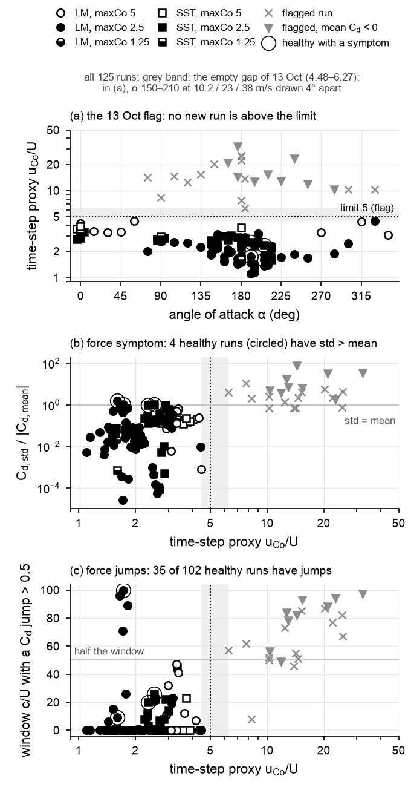
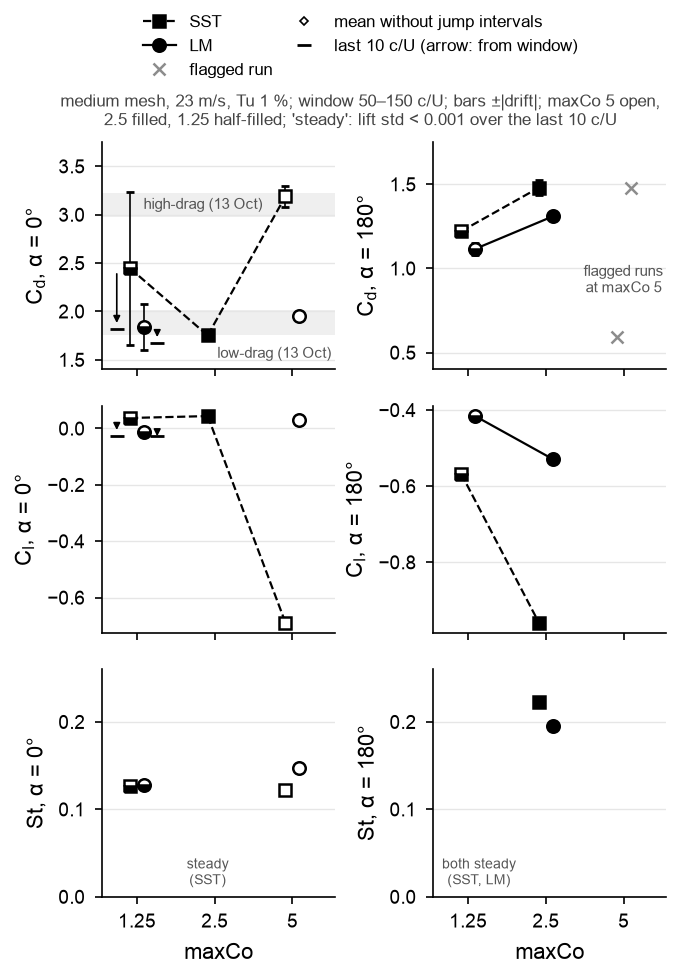
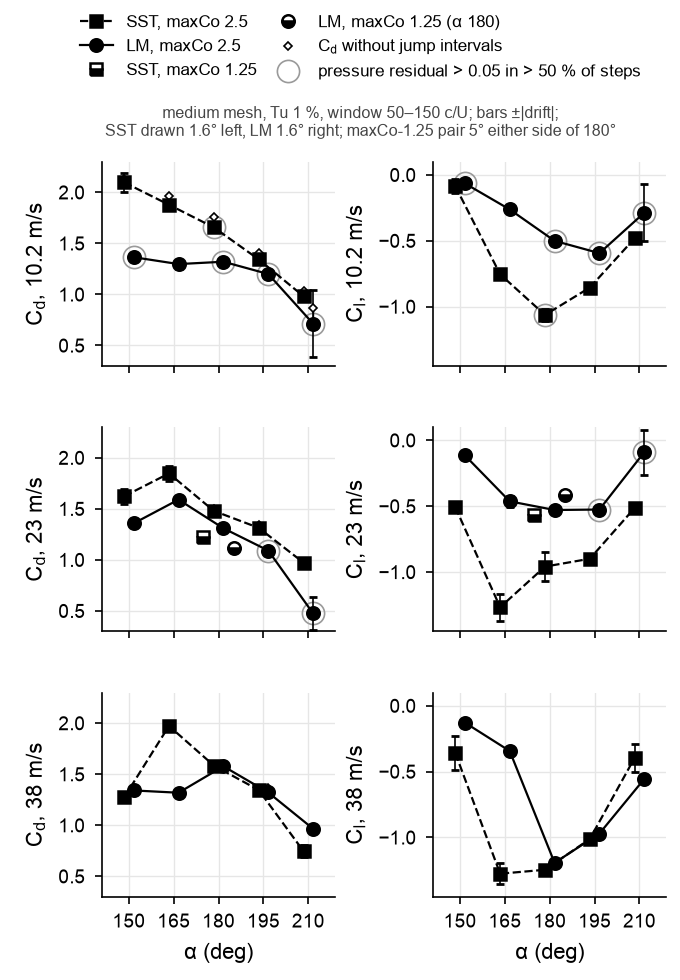
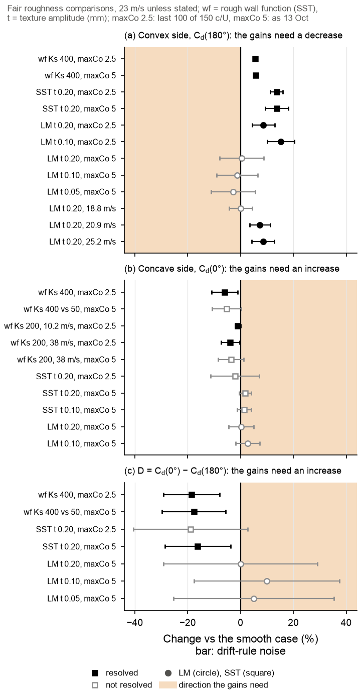
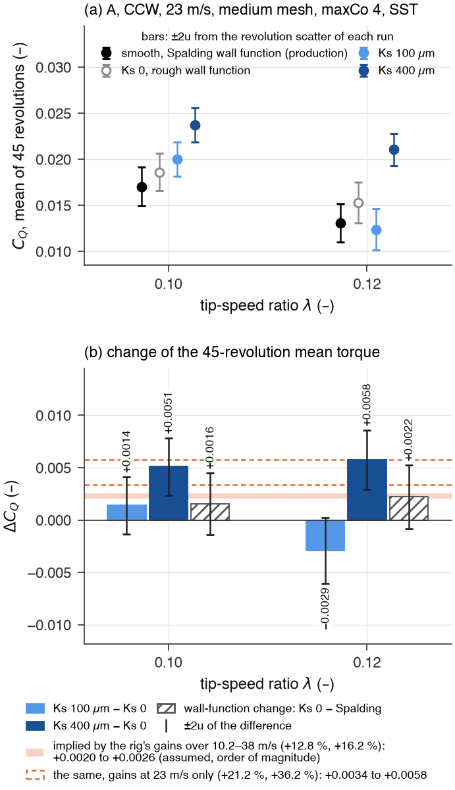
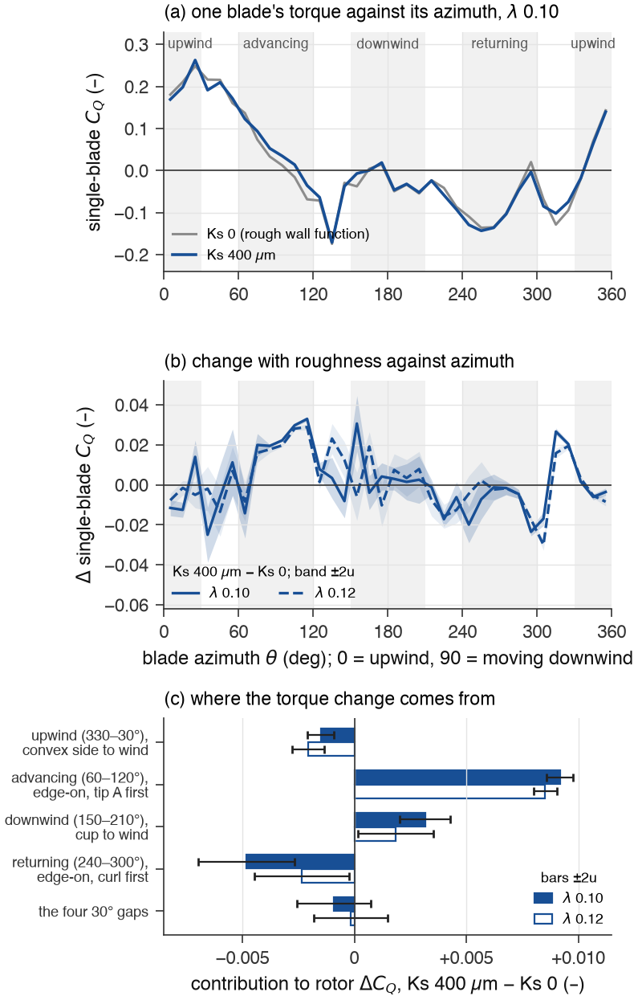
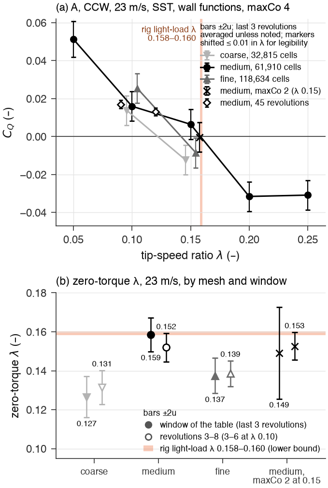

# What the 113 new CFD cases answer

19 October 2026. Teaching version for Stephen Eacuello. Faculty summary:
[TEAM_SUMMARY.md](TEAM_SUMMARY.md); files and reruns: [README.md](README.md); 13 Oct analysis:
[../2026-10-13/RESULTS.md](../2026-10-13/RESULTS.md).

**Scope.** 113 cases finished on Unity after 13 Oct (74 section, 26 roughness, 13 rotor), for 263 in
the tables, plus three diagnostic runs: the Mac's α-0 maxCo-5 SST run repeated on Unity, and two
restarts. Each stage was analysed with `src/` and checked twice by independent scripts, whose
corrections are used here; a final review recomputed the faculty summary from the raw inputs
(`src/team_summary_check.py`) and corrected both documents. Provenance and strength labels follow
13 Oct. "Not resolved" bounds a difference; it never means "equal". All CFD is 2D URANS
(spanwise-coherent shedding, no tunnel walls; the rotor without arms, hub or tips); Tu 1 % and a
1 mm length scale are assumed, and LM is calibrated for attached layers.

**New terms** (others: RESULTS.md).
- *Jump*: Cd changes by more than 0.5 between samples 0.02 c/U apart.
- *Residual signature*: in over half of the window's time steps, the first pressure solve starts
  with an initial residual above 0.05 (22 of the 23 flagged runs have it).
- *Resolved* (section): the change exceeds its noise with and without the jump intervals, and both
  runs keep at least half of the window free of jumps (*usable*).
- *Blade azimuth θ*: 0° upwind, convex side to the wind (section α 180); 90° edge-on, moving
  downwind, tip A first (*advancing*); 180° cup to the wind (α 0); 270° edge-on, curl first
  (*returning*).

## In short

Rough blades raise the 2D rotor's torque at Ks 400 µm by 27–38 % (computed; indicative), the sign of
the measured gains; Ks 100 µm shows no resolved change. The gain comes from the advancing blade
edge-on, which the 13 Oct two-position model leaves out, so that model's prediction of a power loss
fails for assembly A at Ks 400 µm. LM's convex-side drag lies below SST's at 10.2–23 m/s, so a full
trip raises it; its rotor-level sign is untested. maxCo 2.5 is not converged at α 180, and the rotor
torque changes with the mesh by more than the roughness effect.

| 13 Oct | Now | Verdict |
|---|---|---|
| 23 of 51 section runs flagged | 23 of 125; healthy runs can carry jumps | confirmed; split revised |
| maxCo 2.5 untested | not converged at α 180 | overturned |
| α-0 state: time step the likely trigger | machine excluded; time step and start-up | revised |
| Transition test owed | LM below SST at 10.2–23 m/s | answered (indicative) |
| SST texture +13.7 %; D −19.3 % (Ks 400 µm) | +13.6 %; −18.6 % with fair pairs | confirmed |
| LM texture effects within noise (23 m/s) | +8.6 % and +15.3 % at maxCo 2.5, drag-raising | revised |
| Pressure drag ≥ 98.5 % of Cd (28 healthy runs) | ≥ 95.3 % (102 healthy runs; edge-on) | revised |
| Roughness lowers rotor power (inferred) | Ks 400 µm raises the 2D rotor's torque | overturned for the 2D rotor (indicative) |
| Zero-torque λ at the rig's (23 m/s) | medium mesh only | revised |
| 42–66 averaged revolutions resolve the rig-implied ΔC_Q | 55–89 (scatter 15 % larger) | revised |

## 1. Can the new runs be trusted?

**What was run.** The 13 Oct flag, unchanged (u_Co/U = maxCo·Δx_corner/(Δt_mean·U) above 5; Stage 2
uses the time step relative to its run family, the rotor the same proxy), plus the jump and residual
diagnostics.

**How to read.** (a) The proxy against α; flagged runs grey ×. (b) Cd_std/|Cd_mean|; black ring, a
healthy run with a 13 Oct symptom. (c) Window c/U with jumps.

**Result** (computed; established).
- No new run is flagged: 0 of 74 section runs (proxy 1.10–4.46; flagged runs 6.27–32.3), 0 of 26
  roughness, 0 of 13 rotor. Each of the 23 flagged configurations now has a healthy maxCo-2.5 run
  without a 13 Oct symptom (22 re-run; SST α 180 at 23 m/s from 13 Oct).
- The 13 Oct split (symptoms only in flagged runs) fails: four new healthy runs (10.2 m/s, α
  195–210°) have Cd_std > |Cd_mean|.
- Jumps fall in the window of 25 of the 74 new runs (35 of 102 healthy; 13 Oct: 10 of 28), mostly at
  10.2 m/s and α 195°; LM at Tu 0.5 %, 10.2 m/s, α 165–210° is not usable. The residual signature is
  in 15 new runs, all at 10.2–23 m/s and Tu ≤ 1 %. The two diagnostics pick different runs.
- In Stage 2 only the smooth LM α-0 texture run at maxCo 2.5 has jumps; it changes state (§3) and
  is left out.

**Changed from 13 Oct.** The flag still isolates the grossly corrupted runs (confirmed); "healthy"
now admits intermittent disturbance (revised), so comparisons use means with and without jumps.

**Physics** (inferred). With the signature, the PIMPLE correctors do not converge the pressure (new
runs: median first residuals 0.058–0.418, against 0.00015–0.014). It occurs only at low free-stream
eddy viscosity (ν_t/ν ≤ 10.2); jumps occur up to 50.4, so their cause is open.

## 2. Is maxCo 2.5 small enough?

**What was run.** SST and LM at maxCo 1.25, α 0 and 180 (medium mesh, 23 m/s, Tu 1 %), on the
maxCo-2.5 runs' machine and ranks; in Stage 2, the α-90/180 wall-function sweeps and texture
pairs at maxCo 2.5 against 5.

**How to read.** α 0 left, α 180 right; SST squares, LM circles; non-overlapping ±|drift| bars mark
a change beyond noise.

**Result.**
- α 180 (computed; established on this mesh). From maxCo 2.5 to 1.25, Cd falls 17.5 % in SST (1.4793
  to 1.2204, 5.6 times its noise) and 14.8 % in LM (1.3091 to 1.1156, 5.3 times). The shedding (St
  0.2232, 0.1952) decays; the lift std falls below 0.001 only from 90 c/U (SST) and 100 c/U (LM).
  maxCo 5 is flagged here; whether 1.25 is converged is untested.
- Wall functions (established within the model): every roughness effect on Cd and Cl at α 90 and 180
  keeps its sign; the Cd effects move by at most 1.02 percentage points (α 90, Ks 400 µm: +44.40 %
  to +45.43 %; α 180: +5.81 % to +5.50 %), the lift effects by up to 2.87 points (α 90, Ks 400 µm:
  +64.1 % to +67.0 %) ([fig/roughness_timestep_sweeps.png](fig/roughness_timestep_sweeps.png)).
- Texture mesh: the SST texture effect at α 180 is +13.68 % at maxCo 5 and +15.48 % at 2.5 over the
  same 30–80 c/U (+13.62 % over 50–150), but the levels fall 17.5 % (smooth) and 16.2 % (t 0.20)
  over 30–80 c/U and the runs swap flow patterns, so only the sign is established. The low-drag α-0
  levels fall 1.0–5.6 % over 30–80 c/U (6.3–9.1 % comparing each run's own window).

**Changed from 13 Oct.** "maxCo 2.5 untested" is overturned at α 180. The 13 Oct SST α-180 values
(1.48–1.67, "21–37 % above the shell value") and the grid study there rest on unconverged runs.

**Physics.** The time step changes the regime: the convex-side wake sheds at maxCo 2.5 and settles at
1.25 (computed). Why is unresolved; unconverged pressure solves do not explain it, since seven
maxCo-2.5 runs shed strongly with a residual share below 0.05. A real bluff body at Re_c 7.3e4 sheds
(literature), so a converged steady 2D wake would be a model property. The wall-function effects
and the sign of the SST texture effect survive the time step, the LM texture effects do not (§6),
and absolute levels do not.

## 3. What selects the α-0 state?

**What was run.** The Mac's maxCo-5 SST run repeated on Unity (8 ranks, not 4); the maxCo-1.25
runs; two 60-c/U restarts from 150 c/U: (a) the high-drag field at maxCo 2.5, (b) the low-drag field
at maxCo 5. Key figure: [fig/section_timestep_histories.png](fig/section_timestep_histories.png),
rows 1–5 (dotted line: Cd 2.5, the boundary between the states).

**Result** (computed).
- Machine (established): the repeat follows the Mac history sample by sample (largest |ΔCd| 0.038;
  Cd 3.1894 against 3.1905).
- Time step: SST is high-drag at maxCo 5 and low-drag at 2.5. At 1.25 it sheds with Cd 2.77–3.20
  but near-zero mean lift (13 Oct high-drag state: −0.27 to −0.70) until about 100 c/U, then decays
  to 1.822 over the last 10 c/U, still falling. LM is low-drag at maxCo 5 and ends low-drag at 1.25
  (1.676, still falling).
- Restarts: (a) keeps full shedding for 60 c/U; (b) keeps its drag, but its lift oscillation grows
  11-fold while the growth slows (e-folding 11, then 38 c/U): a switch is unresolved.
- Texture mesh: the smooth α-0 runs at maxCo 2.5 leave the high-drag state at 35 c/U (SST) and
  135 c/U (LM).
- Within a state the time step moves SST's Cd by about 1 % (restarts over 180–210 c/U against their
  parent's last 50 c/U: +1.08 %, +0.81 %), but LM's low-drag value falls 13.6 % from maxCo 5 to 1.25
  (last 10 c/U each).

**Changed from 13 Oct.** Machine excluded (established). For SST the start-up selects the state at
maxCo 2.5 (a fresh start ends low-drag, the high-drag field persists); at maxCo 5 a fresh start ends
high-drag and the low-drag field keeps its drag for 60 c/U while its lift oscillation grows; at 1.25
the start-up shedding dies out (indicative; one run per setting). This revises 13 Oct ("the likely
trigger"), the 14 Oct journal ("bistable") and the addendum's "no switch is seen". The state also
goes with Tu: on 13 Oct, LM at maxCo 5 was low-drag at Tu 1 % but high-drag at 0.5 and 3 %.

**Meaning** (inferred). With the maxCo-1.25 values (last 10 c/U; α 0 still falling) the SST drag
ratio k = Cd(0)/Cd(180) is 1.49, a two-position λ0 of 0.100, below the rig's light-load 0.158–0.160
(measured). But that model does not describe A (§7), whose 2D zero-torque λ is 0.127–0.159, so a low
k does not rule out the low-drag state.

## 4. The 360° LM polar

Healthy LM runs (23 m/s, Tu 1 %) now cover all 24 angles at mixed maxCo, 2.5 at 75–255°, 285, 300
and 330° (computed; indicative; [fig/section_polar.png](fig/section_polar.png)). The convex-side drag
peaks at 165° (1.590), not 180° (1.309). Over the 102 healthy runs pressure drag is at least 95.3 %
of Cd (LM, α 255; 98.8 % at α 0 and 180; 13 Oct: at least 98.5 % over 28), so taps would miss up to
4.7 % edge-on.

## 5. The transition test

**What was run.** LM (laminar start, predicted transition) against SST (fully turbulent, the
stand-in for a tripped layer) at α 150–210° and 10.2, 23 and 38 m/s, medium mesh, maxCo 2.5, Tu 1 %;
LM also at Tu 0.5 and 3 %; plus a maxCo-1.25 pair at α 180, 23 m/s. Pairs share mesh, maxCo, speed,
Tu and window.

**How to read.** Rows are speeds; Cd left, Cl right; SST squares, LM circles; grey ring, residual
signature. Tu and speed: [fig/section_transition_tu.png](fig/section_transition_tu.png),
[fig/section_transition_a180.png](fig/section_transition_a180.png).

**Result** (computed; indicative).
- At 10.2 and 23 m/s LM's drag is below SST's in all 10 pairs (−10.7 to −51.1 %), 9 resolved, each
  with jumps or the residual signature in at least one run. At 38 m/s the sign is mixed.
- At α 180 the gap closes with speed: −20.3, −11.5 and −0.45 % at 10.2, 23 and 38 m/s. At 38 m/s the
  difference exceeds its drift noise (1.6 times) but lies far inside two sampling standard errors
  (0.19): the drags nearly meet. At maxCo 1.25 (23 m/s, no jumps or signature) LM is 8.6 % below SST.
  The lift changes more: |Cl| rises 112, 81 and 4 % from LM to SST (36 % at maxCo 1.25).
- Within LM at α 180, Cd rises 20.5 % from 23 to 38 m/s as separation and the skin-friction peak move
  toward SST's; at fixed Tu, ν_t/ν also rises with speed, so this is not a pure Reynolds-number trend.
  Cd falls with Tu at every speed (−17.0 % from Tu 1 to 3 % at 23 m/s) while separation moves by at
  most 0.011 c: Tu acts through the wake (inferred).

**Caveats.** At maxCo 1.25 SST's separation moves from s/c 1.333 to 1.250 (LM 1.237 to 1.227), so
most of the 0.097-c gap at maxCo 2.5 is a time-step effect in SST. The Tu 1 → 3 % effect (−17.0 %)
is as large as the time-step effect (−14.8 %). SST's medium-mesh value at α 180, 23 m/s is the
13 Oct grid outlier (10 % below coarse and fine), as large as the gap; LM has no grid check.

**Changed from 13 Oct.** The owed test is done within LM's limits; the Re and Tu dependence at
α 180 is resolved within LM.

**Meaning.** A full trip, read as the change from LM to SST, raises the convex-side drag by 25.5 %
at 10.2 m/s, 13.0 % at 23 m/s (9.4 % at maxCo 1.25) and 0.45 % at 38 m/s (computed): a loss on the
two-position model. The concave side is unsettled: at maxCo 1.25, D is 0.583 (LM) and 0.602 (SST)
over the last 10 c/U, with both α-0 runs still falling. As that model does not describe the rotor
(§7), the rotor-level sign of a trip stays open.

## 6. Roughness on the section, re-checked

**What was run.** The SST rough-wall sweeps (Ks 0–400 µm) at α 90 and 180 at maxCo 2.5; the meshed
texture at maxCo 2.5 over 150 c/U (SST and LM, α 0 and 180, t 0 and 0.20 mm, LM also 0.10 mm); LM
texture pairs at α 180 at 18.8, 20.9 and 25.2 m/s, bracketing the measured onset.

**How to read.** 29 of the 52 fair comparisons, including all 8 with the needed sign (the full list:
`out/roughness_bottom_line.csv`), each with its noise bar; filled = resolved; orange: the direction
the gains need.

**Result.**
- Bottom line (computed; established within these models): of 52 fair comparisons, 21 are resolved,
  and all 21 raise Cd(180), lower Cd(0) or lower D; none of the 8 with the needed sign is resolved.
- D (established within the wall-function model): with both angles at maxCo 2.5 and α 0 high-drag,
  D falls 8.61 % at Ks 200 µm (1.01 times its noise, marginal) and 18.59 % at 400 µm (1.76 times)
  ([fig/roughness_drag_difference.png](fig/roughness_drag_difference.png)).
- SST texture, α 180 (sign established, size indicative): +13.62 %. On the smooth face the suction
  peak of the tip-B half (Cp −3.19) sits ahead of the shoulder, where the surface still faces
  upstream, so it pulls the blade upstream: thrust. The texture caps the peak (−1.81), which accounts
  for 87 % of the rise of the convex face's pressure drag (0.088 to 0.279)
  ([fig/roughness_surface_a180.png](fig/roughness_surface_a180.png)).
- LM texture, 23 m/s (indicative for the sign): +15.28 % (t 0.10) and +8.61 % (t 0.20) at maxCo 2.5
  (+14.83 % and +9.22 % over the maxCo-5 window, 30–80 c/U), against −1.30 % and +0.36 % at maxCo 5;
  most of the change is in the smooth reference (−13.84 % with the halved step, same window), and
  the response is not monotonic in t.
- LM speed bracket (indicative): the t-0.20 effect is +0.04 % at 18.8 m/s (not resolved), then
  +7.31, +8.61 and +8.50 % at 20.9, 23.0 and 25.2 m/s
  ([fig/roughness_lm_speed.png](fig/roughness_lm_speed.png)). The step is in the smooth blade: its
  tip-B layer separates 0.172 c before the tip at 18.8 m/s and 0.023 c at 20.9 m/s, and its drag
  falls 6.50 %, while the textured blade varies by at most 1.60 %.
- The smooth SST–LM sign at α 180 flips between meshes (−5.43 % here, +13.0 % on the medium mesh),
  and the 13 Oct +18.6 % D difference stays unresolved (the smooth LM α-0 run changes state).

**Caveats.** This mesh's smooth Cd(180) is 39 % below the medium mesh's (SST 0.903 against 1.479),
while at α 0 the two agree within 0.5 %; its 40-µm wall spacing is the inferred cause. Absolute
Cd(180) carries about 40 % mesh uncertainty on top of 15–19 % from the time step. Longer windows
lower the α-180 drift noise (LM: 3.9–5.1 % of Cd, 13 Oct: 4.5–8.4 %), still about twice the
2.0–2.6 % the gains need (two-position model). One texture seed; 2D ridges at nominal amplitude.

**Changed from 13 Oct.** D and SST texture confirmed; LM texture revised from "within noise" to
resolved increases; new: an LM onset between 18.8 and 20.9 m/s.

**Meaning** (inferred). Where the smooth layer holds a strong shoulder suction (SST at 23 m/s; LM at
23–25.2 m/s), the texture caps it and costs thrust; at 18.8–20.9 m/s the textured peak is stronger,
yet the drag still rises. The LM onset falls at the step where FS 0.20's measured gain jumps
(+12.6 ± 11.1 % at 18.8 m/s to +31.5 ± 4.3 % at 20.9 m/s, pointwise 95 %), but the CFD texture
never lowers the section drag.

## 7. Rough blades on the rotor

**What was run.** Assembly A, curled tip leading, 23 m/s, SST, medium mesh, maxCo 4, λ 0.10 and 0.12;
50 revolutions, the last 45 averaged; the rough wall function at Ks 0, 100 or 400 µm, or the
production smooth (Spalding) one. Ks 100 µm is near FS 0.20's measured scan height (84–97 µm,
Ks = k assumed), 400 µm near its nominal-texture upper estimate (422 µm).

**How to read.** (a) C_Q of each run; (b) the changes, resolved when the ±2u bar clears zero
(hatched: Ks 0 − Spalding); orange band and dashed lines, the rig-implied change (mappings assumed).

**Result** (computed; indicative for Ks 400, unresolved for Ks 100).
- Ks 400 − Ks 0: +0.0051 ± 0.0028 at λ 0.10 (+27.4 %, 3.7u) and +0.0058 ± 0.0028 at λ 0.12 (+37.6 %,
  4.1u), also resolved with batch means, of one sign in both window halves, almost all pressure
  torque; the drift rule passes at λ 0.10 and fails at 0.12.
- Ks 100 − Ks 0: +0.0014 ± 0.0027 and −0.0029 ± 0.0032, not resolved; at λ 0.12 the interval ends
  at +0.0002, below every rig-implied change (≥ +0.0020) by more than 2u. Ks 400 − Ks 100 is
  resolved.
- The Ks-400 change is 2.0–2.8 times the change implied by the speed-averaged gains (+0.0020 to
  +0.0026) and 0.9–1.7 times that implied by the 23 m/s gains (+0.0034 to +0.0058).
- Ks 0 − Spalding is not resolved in net but shifts about 0.007 between the edge-on sectors: the
  reference must be Ks 0.

**How to read.** (a) One blade's C_Q against θ; (b) the Ks-400 difference, ±2u; (c) each sector's
share of the rotor's ΔC_Q.

**The torque budget** (computed; one mesh).
- Smooth rotor (Spalding, λ 0.10): upwind +0.0670, advancing +0.0216, downwind −0.0116, returning
  −0.0489, gaps −0.0110; net +0.0170. The upwind blade drives; the main brake is the returning
  edge-on blade, not the cup-to-the-wind one.
- Ks 400 − Ks 0 (λ 0.10 / 0.12; all resolved at 2u): advancing +0.0092 / +0.0085 (2u 0.0006 / 0.0005),
  downwind +0.0032 / +0.0018 (0.0011 / 0.0017), returning −0.0048 / −0.0024 (0.0022 / 0.0021),
  upwind −0.0015 / −0.0021 (0.0006 / 0.0007).
- At θ 80–100° the blade's streamwise force rises 50.0 % / 47.7 % (section drag at α 90: +45.4 %); at
  θ 260–280° it changes by +0.7 ± 3.8 % / +1.9 ± 3.7 % (not resolved).

**Physics.** In A the cups open toward the shaft and the chord lies 6° off the circumference, so at θ
0 and 180 the wind's drag acts across the blade's motion and only the crosswind force turns the
rotor; edge-on, the drag pushes the advancing blade and brakes the returning one. Roughness raises
the edge-on drag of the advancing blade by about half; at the returning blade's edge-on centre
(θ 260–280°) the drag does not change resolvably, and the returning sector's extra braking offsets
about half (λ 0.10) and a quarter (λ 0.12) of the advancing gain. This asymmetry carries the net gain
(computed). Why the returning blade responds less is inferred (its flow already separates at the
curl); no section run exists at α 270.

**Changed from 13 Oct.** The inference that the rough-wall section changes imply a power loss is
overturned for this 2D rotor at Ks 400 µm (indicative); the section changes stand. The "second sign
conflict" (the two-position λ0 falling to 0.129) is not supported at λ 0.10–0.12; a gain of about
0.005 persisting to zero torque would raise the zero-torque λ by about 0.007–0.011 (inferred,
untested).

**Caveats.** Mesh differences of C_Q (up to 0.019, §8) exceed the effect, and the 13 Oct time-step
check cannot exclude an error of the same size; both are assumed, not shown, to cancel. Ks 400 µm
sits at the edge of the rough log law (Ks/y_P 0.92). The wall function alone (Spalding against Ks 0)
moves the edge-on force by 11–23 %.

## 8. Rotor numerics

**What was run.** Coarse and fine meshes (32,815 and 118,634 cells; medium 61,910) at λ 0.10 and
0.15 (23 m/s, maxCo 4); the 38 m/s, λ 0.30 case over 16 revolutions.

**How to read.** (a) C_Q against λ per mesh, ±2u. (b) Zero-torque λ by mesh; the orange band is the
rig's light-load λ, a lower bound, so CFD values should sit at or above it.

**Result** (computed).
- Mesh (established that C_Q at maxCo 4 is mesh-dependent): at λ 0.10, C_Q is 0.0138, 0.0160 and
  0.0254 (coarse, medium, fine), rising but diverging; at λ 0.15, −0.0122, +0.0065 and −0.0086.
  Differences reach 0.019, 2.0–3.7 times the Ks-400 effect. At fixed maxCo the time step shrinks with
  the cells, so mesh and time step are confounded: the medium mesh at maxCo 2 differs unresolvably
  from fine and only just from coarse.
- Zero-torque λ at 23 m/s (indicative): 0.127 ± 0.011 (coarse), 0.159 ± 0.009 (medium), 0.137 ± 0.009
  (fine), against the rig's 0.158–0.160; coarse and fine lie below it beyond 2u.
- 38 m/s: 16 revolutions give C_Q −0.0588 against −0.0549 from 8 (difference −0.0039 ± 0.0189):
  consistent; the 13 Oct last-two-revolution difference was one high revolution
  ([fig/rotor_histories.png](fig/rotor_histories.png)). The zero-torque λ stays 0.156 ± 0.030, 0.051
  below the rig's 0.207 ([fig/rotor_lambda_vs_U.png](fig/rotor_lambda_vs_U.png)).
- Noise (established): revolution means are close to independent but scatter 15 % more than
  estimated (σ_rev 0.00674), so 2u of a 45-revolution difference is 0.0027–0.0032, not 0.0025. The
  rig-implied change needs 55–89 averaged revolutions per run (speed-averaged gains; 13 Oct: 42–66)
  or 11–33 (23 m/s gains) (estimated, σ_rev 0.00678 of the eight long runs); 50 revolutions took
  7.4–14.6 h on 16 ranks (measured).

**Changed from 13 Oct.** The mesh error becomes a computed 0.012–0.019 (13 Oct, inferred: 0.005–0.01);
the 23 m/s match holds on the medium mesh only (revised); the 38 m/s shortfall is confirmed.

**Physics** (inferred). The mean torque is a small difference between drive and brake (one blade's
C_Q swings by ±0.2), so small flow changes move it by about 0.01 and the zero-torque λ by 0.013–0.02.

## 9. What it means for the wind-tunnel gains

1. **The section and rotor results do not conflict.** Every resolved fair section comparison has the
   sign of a loss on the two-position model, yet the same rough wall function raises A's 2D torque at
   Ks 400 µm (computed); that model does not describe A (inferred from the torque budget).
2. **A fully turbulent rough wall is no longer excluded, but it is not shown either.** At Ks 400 µm
   it raises A's torque by 0.9–2.8 times the rig-implied change; at Ks 100 µm nothing is resolved,
   and at λ 0.12 the change stays below the rig-implied one by more than 2u. Under Ks = k, Plain,
   FS 0.05 and FS 0.10 all have about 38 µm, so a sand-grain mechanism could not separate FS 0.10
   from Plain. The Ks of a printed skin is assumed, and mesh and time-step errors exceed the effect.
3. **Transition is still a candidate; its decisive test is now on the rotor.** At 10.2–23 m/s a trip
   raises the section's convex-side drag, but A's drive at θ 0 comes from the crosswind force, and a
   trip changes the α-180 lift more than the drag (|Cl| +81 %, Cd +13.0 % at 23 m/s). Its effect on
   A's torque is untested.
4. **Open alternatives:** transition on the 3D printed texture; 3D or rotating-flow effects; print,
   mounting or run-order effects (one print and one mounting per level).

## 10. Next steps (revised)

1. **Rig.** Assembly and rotation sense (all rotor CFD assumes A, curled tip leading); a wind-off
   coast-down; the test section's size and Tu.
2. **Blade-section test, Plain against FS.** Cd and Cl at α 0, 90 and 180 (270 if possible): α 90
   carries the rotor's roughness response, Cl at 180 its drive, Cd at 0 and 180 the α-0 state. The
   accelerometer (≥ 810 Hz) shows whether the convex side sheds (SST, maxCo 2.5: St 0.2232, 107 Hz
   at 23 m/s).
3. **FS 0.40/0.80 round** as planned on 13 Oct.
4. **Rotor CFD.** Separate mesh and time step (fine, and medium at both λ, at maxCo 2); then a Ks
   0/400 pair on the fine mesh at λ 0.10 with 55–89 averaged revolutions (about three times a medium
   run per revolution, estimated); then Ks 200 µm (nominal FS 0.10: 211 µm) and λ ≥ 0.15.
5. **Section CFD.** maxCo 0.625 at α 180 (about twice the 7.1–11.0 h of a maxCo-1.25 run,
   estimated); the α-0 maxCo-1.25 runs to 300 c/U; restart (b) for another 150 c/U; the decisive
   transition points at maxCo 1.25; a rough-wall run at α 270; a mesh study at α 180.
6. **An LM rotor case**, the only direct test of a trip on the rotor, takes roughly 10–20 days on 8
   ranks (13 Oct estimate) and needs a decision.
7. **Records** (not edited here): two post-processing defects (README.md); the 14 Oct RUN_JOURNAL and
   13 Oct RESULTS.md need these revisions (§2.3–2.4 and 2.8, §3.3–3.4 and 3.7, §4.3 and 4.6, the
   addendum; the table under "In short" lists them).
