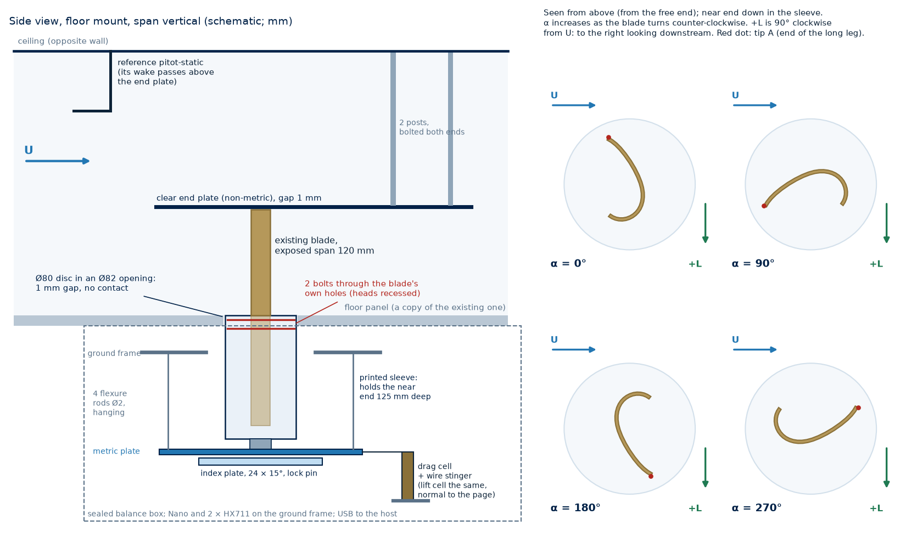
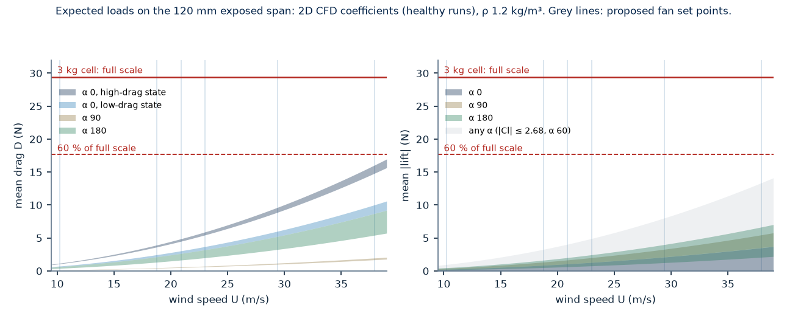
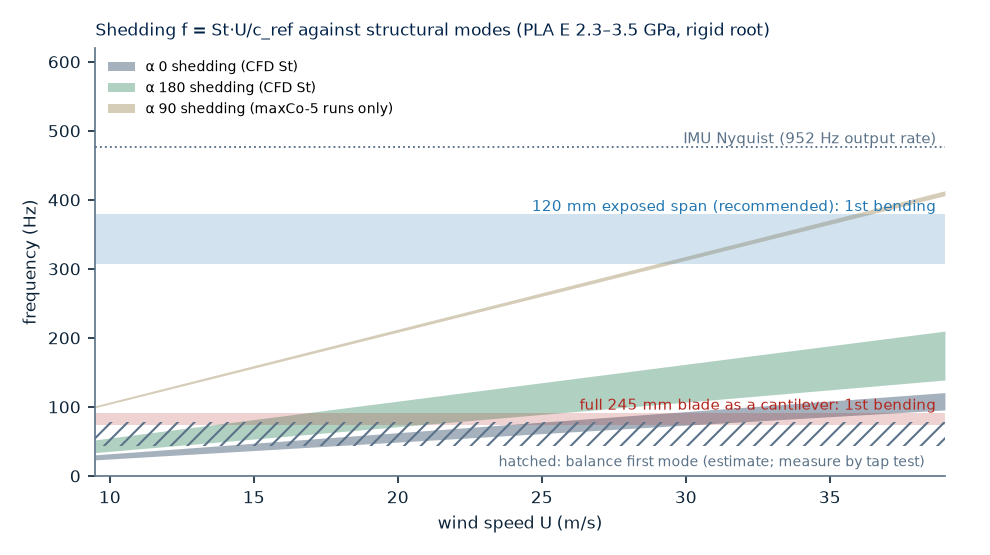

# Blade-Section Force Test — design

The design of the "airfoil slice" test Prof. Jahangiri asked for on 7 Oct: lift and drag
coefficients of the blade section, measured and from theory. It is also step 2 of
`cfd/analysis/2026-10-15/TEAM_SUMMARY.md`: Cd and Cl of Plain against fuzzy-skin (FS) blades at
α 0, 90 and 180, and whether the convex side sheds vortices.

**Status, 22 Oct 2026: designed, not built.** Nothing here is a measurement of the section test.
Every calculated number comes from `docs/diagrams/build_section_test.py`, which writes them to
`docs/diagrams/section_test_numbers.json` and draws the three figures; the prices of §4 are
estimates. Each claim is labelled:

- **measured**, **CAD** (from `blades/v1.stl`) or **CFD** (healthy runs of the 263 cases);
- **calculated**, **datasheet** or **literature**;
- **assumed** (no data yet) or **proposed** (a design choice).

The firmware, logger and analysis are a separate task: `firmware/section_balance/`,
`scripts/section_balance_logger.py` and `scripts/section_balance_analyze.py`. This document covers
the hardware, the calibration and the test plan they serve.

The conventions are the CFD's (`cfd/section2d/README.md` §1):

- α 0: the cup (concave side) faces the wind;
- α 90: the wind runs along the chord from tip A (end of the long leg) to tip B (end of the curl);
- α 180: the convex side faces the wind;
- c_ref = 48.0 mm.

---

## The design in one table

| Question | Decision |
|---|---|
| Test piece | An existing blade, unmodified. Its near end (the end with the two holes) sits 125.0 mm deep in a printed sleeve; 120.1 mm is exposed. |
| The full 245 mm span? | No. As a cantilever, its first bending mode locks in with vortex shedding inside the test range. Held at both ends, it needs a yoke round the tunnel. |
| Where | The floor, span vertical, through a copy of the floor panel; the ceiling as the alternative. |
| Balance | A floating metric plate on four flexure rods. Drag and lift each go to a 3 kg bar cell through a wire stinger, with overload stops. |
| α | A 24-hole index plate (15° steps) on the metric side, so the cells stay in wind axes. |
| q | A pitot-static tube and a differential-pressure sensor, calibrated in place against a liquid manometer. |
| Check body | 1-1/2 in schedule-40 PVC pipe (Ø 48.3 mm): known drag, zero mean lift. |
| First test matrix | Plain, FS 0.10 and FS 0.20 at α 0, 90 and 180, at 500, 1100 and 1800 rpm. Mounting order Plain, FS 0.10, FS 0.20, Plain, FS 0.20, FS 0.10, Plain. |

---

## 1 · The test piece

### 1.1 The whole blade across the test section: no

- **Fit.** For the walls to act as end plates, each gap must be 0.5–1 mm. That needs a dimension
  along the span of 246.1–247.1 mm (CAD span 245.11 mm). A wider section needs end plates and a
  support through each wall.
- **Vibration.** Held at one end, the blade's first bending mode is 74–91 Hz (calculated; PLA
  E 2.3–3.5 GPa assumed; rigid root).
  - Shedding at α 180 (CFD St 0.171–0.256) crosses it at 13.8–25.5 m/s.
  - Shedding at α 0 (CFD St 0.118–0.147) crosses it at 24.1–37.1 m/s.
  - Both speeds are inside the test range. Lock-in on a light PLA cantilever risks fatigue at the
    root and a part in the flow.
- **Twist.** The cup is an open section, with a torsion constant of 146 mm⁴ (calculated). Held at
  one end, it would twist 16° at α 90 and 38 m/s (St Venant; E 2.3 GPa; calculated).
- **Both ends held.** The first mode would rise to 469–579 Hz (calculated). But both spindles must
  then reach one balance, through a yoke round the outside of the tunnel. That is not a 1–2 week
  build.

### 1.2 Recommended: an existing blade, near end held in a sleeve

The blade's two holes are 110.0 and 119.9 mm from its near end, Ø 5.08 mm (CAD). A sleeve
125.0 mm deep holds the near end, both holes and 2.6 mm beyond them. The exposed span is
**b_e = 120.1 mm**, an aspect ratio b_e/c_ref of 2.50. Two bolts through the blade's own holes
retain it, as on the rotor.

- **Unmodified.** It uses the blades that gave the 1 Oct gains (measured: FS 0.10 +12.8 %,
  FS 0.20 +16.2 % peak power). Any v1 blade of the coming print round fits the same sleeve.
- **Stiff.** The first bending mode is 307–379 Hz about the weak axis and 838–1033 Hz about the
  strong axis (calculated, rigid root; the slot clearance and the PETG sleeve lower it, and the
  tap test of §6.2 measures it). That is above shedding at α 0 and 180 at every speed (≤ 203 Hz
  at 38 m/s).
  - Edge-on shedding at α 90 appears only in the CFD's maxCo-5 runs (St 0.50). If it is real, it
    reaches the weak mode at 29.1–36.4 m/s. The IMU check in §6 settles it.
  - At α 0 and 180 the drag acts along the weak axis and the shedding lift along the strong one.
    Drag fluctuations at twice the shedding frequency reach the weak mode at α 180 from 28.7 m/s
    (at 1800 rpm they span 270–405 Hz; calculated). The bursts at 1800 rpm show any response.
- **Strong.** At the largest mean drag, 16.1 N (§3), the root stress is 3.3 MPa and the free end
  moves 0.35 mm sideways (calculated, E 2.3 GPa). The full span at the same Cd and speed
  (32.8 N) would give 13.7 MPa.
- **It still twists.** The aerodynamic moment acts about the shear centre, 15.5 mm from the
  centroid towards the convex side (calculated). At 23 m/s the tip turns (calculated; E 2.3 GPa,
  ×0.66 at 3.5 GPa; the low bound holds the root's warping, the high bound leaves it free):
  - 0.5–1.4° at α 90;
  - 1.0–2.9° at α 0 and 180;
  - 2.7 times as much at 38 m/s.

  With the local slopes of the CFD polar, the span-mean twist changes the coefficients by
  (calculated):

  | α | 23 m/s | 38 m/s |
  |---|---|---|
  | 90 | Cd 0.9–3.5 %, Cl 0.8–3.1 % | Cd 2.4–9.5 %, Cl 2.1–8.4 % |
  | 180 | Cd ≤ 0.2 %, Cl ≤ 1.4 % | Cd ≤ 0.5 %, Cl ≤ 3.9 % |
  | 0 | Cl by 0.02–0.08 | Cl by 0.06–0.23 |

  The twist is photographed (§6.2). At one set point it is nearly the same for Plain and FS.
- **Like the rotor.** On the rotor, each half of the blade is about this long and is held at the
  mid-span holes (inferred from the CAD). It bends and twists there in the same way.
- **Located on untextured features only.** The slicer summary records no fuzzy skin on the end
  caps, the square edges or the hole bores; check each blade with calipers.
  - The near-end face sets the spanwise position.
  - The two hole bores set the position in the section.
  - The square tip faces set the rotation: a fixed stop at tip B and a nylon-tipped set screw at
    tip A.
  - The slot clears the textured faces by 0.3 mm (FS ≤ 0.20; more for FS 0.40 and 0.80). Every
    texture level therefore has the same α reference.

### 1.3 The test sections it suits

| Requirement | Value | Why |
|---|---|---|
| One wall, floor or ceiling, can be replaced by a copy with an Ø 82 mm opening | — | The sleeve and balance sit behind it (§2.4) |
| Depth behind that wall | about 0.29 m | 140 mm sleeve, plus the metric plate, index plate, cells and box (proposed) |
| Dimension along the span | ≥ 0.15 m | 120.1 mm span, 1 mm gap, 3 mm end plate and its posts; any section that holds the rotor has it |
| Cross-section C for absolute Cd within ±5 % of blockage at α 180 (§5.4) | ≥ 0.124 m² | e.g. 0.36 m square |
| The same in the α-0 high-drag state | ≥ 0.267 m² | 0.52 m square |
| A smaller C | — | Plain against FS still compares: the correction nearly cancels. Absolute values carry the θ band of §5.4. |

The test-section size is not yet measured (`cfd/MEASUREMENTS_NEEDED.md` §2;
`docs/checklists/rig_records_next_visit.md` item 3).

### 1.4 Gap and end plate

- **Free-end gap.** g = 1.0 mm (proposed): 0.8 % of b_e and 2.1 % of c_ref. Set it with feeler
  gauges and check it at every α. Bending moves the free end sideways, not along the span, so the
  gap stays open.
- **End plate (non-metric, proposed).**
  - Clear polycarbonate, 3 mm thick, 360 × 192 mm.
  - It runs from 2.5 c_ref (120 mm) upstream of the spindle axis to 5 c_ref (240 mm) downstream,
    and is 4 c_ref wide.
  - It is chamfered on the side away from the blade.
  - It is clear so that the free end can be photographed (α, twist).
  - Two posts behind the spindle axis hold it from the opposite wall. Each post is bolted at both
    ends.
- **Its effect is measured, not assumed.** These sizes do not come from a standard. Two blocks
  measure their effect: one with g = 2 mm, and one with the end plate removed. Without the plate
  the tip is free; reflected in the floor, that is an aspect ratio of 5.0, close to the full
  blade's 5.1.
- **Not 2D.** Between the floor and the end plate the aspect ratio is 2.5, so the result is a
  finite-span, end-plated coefficient. Between end plates, a cylinder's fluctuating lift can rise
  as the aspect ratio falls: at aspect ratio 1 it reached almost twice the large-aspect-ratio
  value (literature: Szepessy & Bearman 1992, within Re 8×10³–1.4×10⁵; not at the ends of that
  range, and below about 2×10⁴ the trend can reverse). Unsteady loads and shedding here may
  therefore exceed the 2D CFD's, not fall below them.
- **Root boundary layer.** The root sits in the floor's boundary layer. Its thickness is not
  measured; a pitot traverse in Session 0 measures it.

### 1.5 If the sleeve cannot be used

This applies if no wall has a replaceable panel or enough depth behind it. Then ask the Print Lab
for a section piece per level:

- 120 mm of the v1 section, with a 25 mm solid root plug: an Ø 8 mm bore, a flat for α, and no
  fuzzy skin on the plug;
- printed in the same job, orientation and settings as that level's blades (for the coming round,
  `turbine_320.3mf`).

The exposed span is the same, so the results compare with the existing-blade tests.

---

## 2 · Mechanical concept



### 2.1 Blade and sleeve

- **Sleeve.** Printed in PETG (proposed), Ø 80 × 140 mm. Its top face is the turntable disc: flush
  with the floor, in an Ø 82 mm opening, with a 1 mm radial gap that never closes.
- **Slot.** A crescent 125.0 mm deep, cut from `cfd/geometry/section_v1.csv` and centred on the
  section's area centroid, which is the spindle axis. The outline reaches 30.1 mm from that axis,
  so the Ø 80 mm disc leaves 9.6 mm of material outside the slot (calculated).
- **Bolts.**
  - The holes sit 5.1 and 15.0 mm below the disc face, where the sleeve passes through the floor
    panel (its thickness is not recorded). The bolts therefore have recessed heads and nuts,
    inside the Ø 80 mm outline.
  - Use the same screw as the rotor (#10 or M4; the rotor's size is not recorded). Do not ream
    the blade's holes.
  - Blades are fitted at the bench: lift the sleeve out through the opening, bolt the blade in,
    lower the sleeve back and lock it from below.
- **Support.** The sleeve stands on a spigot that turns in a bushing in the metric plate. A key
  locks it to the index plate.
  - The joint carries the 3.5 N·m overturning moment (§2.2). A bushing alone has play, and a tilt
    of 0.36° at the metric plate moves the disc, 158 mm above it, by the whole 1 mm gap
    (calculated). Clamp the sleeve's base (or the index plate) to the metric plate once α is set,
    for example with a nut on the spigot (proposed).

### 2.2 Balance

- **Floating plate (recommended).** A 6 mm aluminium metric plate, about 0.16 m below the floor,
  hangs from the ground frame on four Ø 2 mm steel rods 110 mm long.
  - The rods carry the weight and the overturning moment: 3.5 N·m at the largest drag, ±14.6 N per
    rod, against a buckling load of 513 N (calculated).
  - They let the plate move freely in drag and lift.
  - Each cell is a vertical column on the ground frame. Its free end pushes on the edge of the
    plate through a stinger in line with the spindle axis: Ø 0.8 mm music wire, 40 mm long. The
    cell sees only the force along its stinger.
- **Shunt and cross-coupling.** The rods carry 3.7–7.2 % of each force. Each stinger adds 0.5–1.0 %
  cross-coupling (calculated, with an assumed cell stiffness of 74–147 N/mm). Both are linear, and
  the in-place calibration removes them.
- **Overload stops.** Four adjustable screws on the ground frame stop the plate at about 110 % of
  a cell's full-scale deflection (proposed). They protect the cells and keep the metric parts
  captive if a cell or stinger fails.
- **Rejected.**
  - Two bar cells stacked under the turntable, the simplest build: their flexures would carry the
    3.5 N·m moment, with the drag acting 0.2 m above them, and their moment rating is not
    specified.
  - A pivoted frame: it measures the moment about its pivot, so it needs the spanwise centre of
    pressure, and end effects move that.
- **Dynamics.** The plate on its cells has a first mode near 43–79 Hz (estimated: 0.6–1.0 kg on
  74–147 N/mm).
  - Shedding reaches that band at 14–32 m/s at α 0 and at 8–22 m/s at α 180.
  - Where the two coincide, the mode's Q amplifies the fluctuating force in the cells.
  - Hence the stops, and a tap test before the first wind run (§6.2).
  - If the tap test shows a Q above about 10, add an oil dashpot (proposed): a vane in viscous
    silicone oil between plate and frame. It damps without carrying a static load.

### 2.3 Turntable, α and the sign of lift

- **Index plate.** 24 holes at 15° on a 120 mm pitch circle, on the metric side. The lock pin is an
  Ø 4 mm ground dowel, captive on a lanyard.
  - In drilled aluminium the play is about 0.02°; printed with brass bushings, about 0.1°
    (estimated).
  - The cells never turn, so drag and lift are measured in wind axes (`balance_frame: wind` in the
    analysis rig sheet).
- **Setting α 0.** Done once, with a printed gauge that slips over the free end. It carries an edge
  parallel to x_body, the normal to the outer-tip chord. Square that edge to a line measured from
  the side wall at two points: ±0.2° (estimated). The PVC cylinder then measures the flow angle
  (§5.1).
- **Floor mount, near end down.** Seen from above, α increases as the blade turns
  counter-clockwise. +lift, the CFD's liftDir, points to the right looking downstream.
  - In a ceiling mount (near end up), both reverse.
  - The analysis's `lift_sign` is +1 when the balance's +lift axis points this way. A
    `cal l ... +` load must pull the blade in that direction.
  - A `cal d ... +` load must pull it downstream: the analysis has no drag sign.
- **Physical check (CFD).** At α 90, +lift points from the convex face towards the open side of the
  cup.

### 2.4 Where it sits, and the wall gap

- **Floor, span vertical.** Gravity acts along the span, on neither cell, at every α, and the blade
  stands as it does on the rotor.
  - A ceiling mount is the same, inverted.
  - A side wall works, but the metric weight then loads the lift cell. A wind-off zero at each α
    removes it from the data, but the cell still carries 19–23 N: 65–79 % of a 3 kg cell. Use a
    5 kg lift cell (39–47 %; calculated).
- **Do not drill the tunnel.** Copy the floor (or ceiling) panel in acrylic, polycarbonate or
  plywood, cut the Ø 82 mm opening in the copy and keep the original. This needs the lab's
  agreement.
- **Seal the box, not the gap.** The balance box (sheet or plywood) seals to the underside of the
  panel with foam tape.
  - The annular gap and the slot then lead to a closed volume. No steady flow passes through them,
    and the box pressure follows the test-section static pressure.
  - Check with a tissue or smoke at the gap at 500 rpm.
  - The gap must never close: run a paper strip round it at every α.
- **Rotor out.** Remove the rotor. Remove its mount and generator if they come out. If they cannot,
  record their position and leave them in place for every run, including the tares and the q
  calibration.

### 2.5 Printed and bought

- **Printed (PETG):**
  - the sleeve, with its disc, slot, key and recesses;
  - the spigot adapter;
  - the α-0 gauge;
  - the calibration dummy (§5.1);
  - the blanking insert for the tare;
  - the PVC-cylinder adapter;
  - cable clips.
- **Bought or machined:** everything else, listed in §4.

---

## 3 · Loads and load cells

**Set points.** q = ½ρU².

- ρ = 1.20 kg/m³ for sizing (assumed); the reduction uses the measured ρ.
- U comes from the fan calibration. It was measured only up to 700 rpm and is extrapolated above;
  `FIELD_CARD.md` labels it ±10 % until verified.
- S = c_ref·b_e = 57.65 cm².

| fan rpm | m/s | q (Pa) | Re_c | qS (N) |
|---:|---:|---:|---:|---:|
| 500 | 10.2 | 63 | 3.2×10⁴ | 0.36 |
| 900 | 18.8 | 211 | 5.9×10⁴ | 1.22 |
| 1000 | 20.9 | 262 | 6.6×10⁴ | 1.51 |
| 1100 | 23.0 | 318 | 7.3×10⁴ | 1.83 |
| 1400 | 29.4 | 520 | 9.3×10⁴ | 3.00 |
| 1800 | 38.0 | 864 | 1.2×10⁵ | 4.98 |

**Expected loads** (CFD coefficients, healthy runs; the CFD has α 90 only at 23 m/s, assumed to
hold at every speed):

| α | CFD Cd | CFD Cl | Drag (N), 1100 / 1800 rpm | Lift magnitude (N), 1100 / 1800 rpm |
|---|---|---|---|---|
| 0, low-drag state | 1.75–2.01 | −0.01 to +0.18 | 3.2–3.7 / 8.7–10.0 | ≤ 0.33 / ≤ 0.89 |
| 0, high-drag state | 2.97–3.22 | −0.70 to −0.27 | 5.5–5.9 / 14.8–16.1 | 0.49–1.29 / 1.33–3.51 |
| 90 | 0.338–0.392 | 0.709–1.096 | 0.62–0.72 / 1.68–1.95 | 1.30–2.01 / 3.53–5.46 |
| 180 | 1.09–1.75 | −1.34 to −0.42 | 1.99–3.21 / 5.42–8.72 | 0.76–2.45 / 2.07–6.65 |



**Extremes** (calculated):

- **Largest mean drag:** 16.1 N, α 0 in the high-drag state at 38 m/s.
- **Largest mean |lift|:** 6.7 N at α 0, 90 or 180. At any α it is 13.4 N (α 60, |Cl| 2.68); that
  value comes from the 23 m/s polar and is assumed to hold at 38 m/s.
- **2D unsteady loads at 38 m/s,** mean + 3 s.d.: 22.5 N drag and 20.1 N lift.
- **Smallest load:** the α-90 drag at 500 rpm, 0.12–0.14 N.

**Load cells.** A TAL220B-class bar cell (datasheet):

- 1.0 mV/V at 3–10 V excitation, so the Nano's 3.3 V rail drives it within specification;
- non-linearity, hysteresis and repeatability ±0.05 % FS each;
- creep ±0.1 % FS per 3 min;
- safe overload 120 % FS.

| Capacity | Max mean drag | Drag, mean + 3 s.d. | Max mean lift, any α | Lift, mean + 3 s.d. | Repeatability | as % of α-90 drag, 1100 rpm |
|---|---:|---:|---:|---:|---:|---:|
| 1 kg | 164 % FS | 229 % FS | 136 % FS | 205 % FS | 4.9 mN | 0.7–0.8 % |
| 2 kg | 82 % FS | 114 % FS | 68 % FS | 103 % FS | 9.8 mN | 1.4–1.6 % |
| 3 kg | 55 % FS | 76 % FS | 45 % FS | 68 % FS | 14.7 mN | 2.0–2.4 % |
| 5 kg | 33 % FS | 46 % FS | 27 % FS | 41 % FS | 24.5 mN | 3.4–4.0 % |

**The choice: 3 kg on both axes** (proposed).

- The largest mean load stays below 60 % of full scale, and the 2D peaks stay below the 120 % safe
  overload with margin.
- One spare cell covers both axes.
- The cost is resolution at α 90 and 500 rpm, where the drag is 0.12–0.14 N and the repeatability
  is 10–12 % of it. Use α-90 drag from 900 rpm up: the repeatability is 2.0–2.4 % of it at
  1100 rpm and 0.75–0.87 % at 1800 rpm (calculated).
- The HX711's noise is far below that: 0.45 mN per sample at 10 SPS and 0.80 mN at 80 SPS (from
  50 and 90 nV rms, datasheet). 10 SPS, the usual module setting, has the lower noise.

**Structural checks.** The figure below collects §1.2 and §2.2: the blade's modes, the balance
mode and the shedding bands.



---

## 4 · Parts list

Prices are approximate, in USD, from Oct 2026 retail. They are estimates, not quotes.

| Item | Description | Qty | ≈ $ |
|---|---|---|---|
| Load cells | 3 kg aluminium bar cell, TAL220B class: about 55 × 12.7 × 12.7 mm, M5 holes, 1.0 mV/V, 3–10 V | 3 (1 spare) | 10–16 each |
| HX711 boards | 24-bit bridge ADC. Split VCC/VDD preferred (e.g. SparkFun SEN-13879); both pins at 3.3 V | 2 (+1) | 2–11 each |
| Controller | Arduino Nano 33 BLE Sense: the tunnel node's board, or a second one (≈ $45) | 1 | on hand |
| Pitot-static tube | 3–6 mm OD, standard tip, ≥ 150 mm stem | 1 | 20–80 |
| Pressure sensor | Sensirion SDP33 (±1500 Pa) on a breakout. Or SDP31 (±500 Pa), with manometer readings above 1300 rpm | 1 | 40–80 |
| Manometer | Inclined liquid manometer, 0–1 kPa. Borrow from the lab first | 1 | 0–80 |
| Tubing | Silicone, 1.5–2 mm ID, equal lengths | 1 m | 5 |
| Floor-panel copy | Acrylic, polycarbonate or birch plywood, the existing panel's size and thickness | 1 | 20–80 |
| Plates | 6061 aluminium, 6 mm: the metric plate (160 × 160 mm) and the frame base | ≈ 0.1 m² | 30–50 |
| Ground frame | 20 × 20 mm aluminium extrusion, corner brackets, T-nuts | ≈ 2 m | 25–40 |
| Flexure rods | Ø 2 mm steel drill rod | 2 × 300 mm | 5–10 |
| Stingers | Ø 0.8 mm music wire | 1 length | 3 |
| Clamp blocks | Aluminium blocks with set screws, or printed with heat-set inserts | 12 | 5–10 |
| Index | Ø 4 mm ground dowel pins (h6), with brass bushings or a drilled aluminium plate | 1 set | 5–15 |
| Spigot bushing | Ø 12 mm bronze bushing, or a 6801-size bearing | 1–2 | 3–10 |
| End plate | 3 mm clear polycarbonate, 360 × 192 mm | 1 | 10–20 |
| Posts | M6 stainless threaded rod, nyloc nuts, washers | 2 | 5–10 |
| Fasteners | #10-24 (or M4) socket screws for the blade holes, M3 and M5 hardware, nyloc nuts, medium thread-locker | kit | 15–25 |
| Calibration weights | 1 g–1 kg set and a hanger, each mass checked on the 0.01 g scale | 1 | 25–60 |
| Pulleys and line | 2 ball-bearing pulleys, ≈ 25 mm; braided PE line, 0.2–0.3 mm | 1 | 15–20 |
| Gasket | Closed-cell foam tape, for the box | 1 roll | 5–10 |
| Cable | 4-core shielded, 2 m, with connectors | 1 | 10–15 |
| Reference cylinder | 1-1/2 in schedule-40 PVC pipe (OD 48.3 mm), 0.3 m | 1 | 5 |
| Dashpot, if needed | Silicone oil, 30 000–100 000 cSt, 100 mL | 1 | 15–20 |
| Filament | PETG for the printed parts, ≈ 0.5 kg | — | 10–15 |

The table sums to about $310–740 with the Nano on hand and a dashpot included (the low end assumes
a borrowed manometer), and to about $260–530 if the lab lends the pitot, the manometer and plate
stock (calculated from the estimates above).

---

## 5 · Calibration and data reduction

### 5.1 Calibration

Calibrate in place, with the final cabling and the box closed. The logger's `cal` and `fit` record
it; the firmware README has the commands.

1. **Warm-up.** Power the electronics 30 min first (assumed practice).
2. **Dummy.** Fit the calibration dummy in the sleeve: a printed blade-shaped tongue carrying an
   aluminium post on the spindle axis. The post has load eyelets 25, 60 and 95 mm above the disc;
   60 mm is the middle of the exposed span.
3. **Loads.**
   - Run a string from the 60 mm eyelet over a ball-bearing pulley clamped outside the section. It
     must be horizontal within 0.5° (angle finder) and lie along the axis (laser line, or marks
     measured from the wall).
   - On each axis, in both directions, apply 0, 20, 50, 100, 200, 500, 1000 and 1500 g, plus 2000 g
     on drag, then remove them in the reverse order. This covers the largest expected mean forces
     (16.1 N drag, 13.4 N lift).
   - The mass is the weights plus the hanger plus the string below the pulley, weighed on the
     0.01 g scale.
4. **Position and moment.**
   - Repeat 1000 g on each axis from the 25 and 95 mm eyelets: this is the load-position
     sensitivity.
   - Apply a pure torque, two strings pulling opposite ways at equal radius: this is the cross-talk
     from moment.
5. **Fit.** counts = a + d·t + K·F on each channel; the analysis refits K with its uncertainty.
   Acceptance (proposed):
   - fit residuals ≤ 0.1 % FS;
   - loading against unloading ≤ 0.1 % FS;
   - cross-talk after correction ≤ 0.2 % of the applied load;
   - between the 25 and 95 mm eyelets, ≤ 0.5 %.
6. **Drift.** At the start of each session, record 30 min of zero with the wind off. At the start
   and end of each session, check 1000 g on each axis: the sensitivity must agree within 0.3 %.
7. **Whole chain and flow angle: the PVC cylinder.** Mount it with the same exposed length, gap and
   end plate, and run 500, 1100 and 1800 rpm (Re 3.3×10⁴ to 1.2×10⁵, calculated).
   - Its mean lift is zero by symmetry. atan(L/D) therefore gives the flow angle and the balance-axis
     misalignment combined, to 0.39° per reading at 1100 rpm (calculated).
   - Its Cd checks the reduction against 1.17, the 2D value (literature, Hoerner 1965). Expect a
     lower value from the finite, end-plated span. It is a check, not a correction factor.

### 5.2 q, ρ and U

- **A measured q is needed.** The fan calibration is measured only up to 700 rpm and is labelled
  ±10 % above (`FIELD_CARD.md`): ±20 % in q. Absolute coefficients therefore need a measured q.
- **Reference probe.** A pitot-static tube at least 0.2 m upstream of the spindle axis, above the
  end plate, so that its wake misses the blade.
- **Station factor.** Once, in Session 0, with the blade removed, the slot blanked and the end plate
  in place:
  - put a second pitot at the blade station (on the spindle axis, 60 mm up), read on the manometer;
  - read it against the reference sensor at every set point;
  - fit q_station = K_q·q_ref.

  This also gives the first measured wind speeds above 700 rpm.
- **Sensor.** SDP33 (datasheet): span repeatability 0.5 % of reading up to 500 Pa and 3 % above. At
  1400 and 1800 rpm, also read the manometer at each dwell.
- **Into the analysis.** Enter `q_pa` = K_q·q_ref per dwell in the run sheet, for the tare dwells
  too: the analysis scales each tare by the ratio of the two q values. The firmware keeps A4/A5
  free for this sensor but does not read it yet.
- **ρ, Re and St.** ρ = p/(287.05 T): p from the board's LPS22HB, T from a reference thermometer
  (the board's own temperature reads high; see the logger's notes). Re and St use
  U = √(2 q_c/ρ).

### 5.3 Reduction

```
1. dwell mean of the raw counts (30 s, from 20 s after the set point); s.e. by batch means
2. zero: the wind-off dwells at the same alpha and mounting, before and after, interpolated in time
3. F = K^-1 (counts - zero)                     drag D and lift L, in wind axes
4. b = 1 + theta (D / q_u) / C                  Maskell (1963): q_c = b q_u, with D the drag this
                                                dwell measured; C = empty cross-section at the blade
5. Cd = D / (b q_u S) - D_t / (b_t q_t S)       t: the tare dwell (blade removed, slot blanked, same
   Cl = L / (b q_u S) - L_t / (b_t q_t S)       set point), corrected the same way; S = c_ref * b_e
6. St = f c_ref / U,  Re = U c_ref / nu         U = sqrt(2 q_c / rho)
```

`scripts/section_balance_analyze.py` implements steps 1–5, with a Monte Carlo uncertainty.
Correcting each dwell with its own drag before the tare is subtracted removes the tare at its own
q. The analysis reports Re from the uncorrected U and St from each burst's fan label; for the
comparison with the CFD, recompute both with U from q_c. Its rig sheet entries for this design:

- `span_m_by_set`: b_e measured for each blade (nominal 0.1201);
- `c_ref_m: 0.048`;
- `balance_frame: wind`;
- `lift_sign`: as §2.3;
- `test_section`: from the measurement;
- `maskell_theta: 1.68` with `u_maskell_theta: 0.41`: the mean and standard deviation of a uniform
  band over the 0.96–2.40 of §5.4 (the analysis draws θ from a normal with that deviation). For
  Cd at each bound, run it with `--theta 0.96` and `--theta 2.40` and `u_maskell_theta: 0`;
- `extra_drag_area_m2: 0` when q is the station-calibrated pitot, because the end plate and posts
  are then inside K_q. Otherwise, the drag area of the end plate and posts.

On the outer tip-to-tip chord (46.16 mm, CAD), every coefficient would be 3.99 % larger. State the
chord whenever a comparison uses another one.

### 5.4 Blockage

Maskell's factor θ runs from 0.96, for a 2D wake (blade wall to wall), to 2.40, for the same span
with a free tip. Both come from Maskell's flat-plate fit θ = 0.96 + 1.94·exp(−0.06·AR), with
AR = 2b_e/c_ref = 5.0 by reflection. The fit is taken from secondary sources; the original was not
checked. The end-plated blade lies between the two values, so report Cd at both bounds.

The table gives the q correction, θ·Cd·S/C, at each bound:

| Square section | C (m²) | S/C | α 0, high-drag (Cd 3.22) | α 0, low-drag (1.75) | α 180 (1.5) | α 90 (0.39) |
|---|---:|---:|---:|---:|---:|---:|
| 0.30 m | 0.09 | 6.4 % | 20–49 % | 11–27 % | 9–23 % | 2.4–6.0 % |
| 0.40 m | 0.16 | 3.6 % | 11–28 % | 6–15 % | 5–13 % | 1.3–3.4 % |
| 0.50 m | 0.25 | 2.3 % | 7–18 % | 3.9–9.7 % | 3.3–8.3 % | 0.9–2.2 % |
| 0.60 m | 0.36 | 1.6 % | 5–12 % | 2.7–6.7 % | 2.3–5.8 % | 0.6–1.5 % |

- **The full 245 mm blade,** for comparison, would block twice as much: S/C of 13.1, 7.4, 4.7 and
  3.3 % (calculated).
- **The α-0 state stays identifiable at every size here.** The two CFD states differ by at least a
  factor of 1.48. The θ band at 0.09 m² spans at most a factor of 1.25 (calculated).

### 5.5 Uncertainty budget

Estimated before any data, at 1100 rpm with 3 kg cells:

| Source | α 90 Cd | α 90 Cl | α 180 Cd | α 180 Cl | In FS − Plain |
|---|---:|---:|---:|---:|---|
| Cell repeatability, 0.05 % FS (datasheet) | 2.2 % | 0.9 % | 0.6 % | 0.9 % | random, ×√2 |
| α setting, ±0.2°, × local CFD slope | 0.8 % | 3.2 % | 0.4 % | 0.2 % | ±0.1° repeat |
| Flow angle, ±0.5°, before the cylinder check (assumed) | 2.2 % | 0.4 % | 0.5 % | 1.4 % | cancels |
| q after the manometer calibration (estimated) | 0.7 % | 0.7 % | 0.7 % | 0.7 % | cancels |
| Calibration slope: weights, pulley, fit (estimated) | 0.3 % | 0.3 % | 0.3 % | 0.3 % | cancels |
| Span b_e, ±0.2 mm | 0.17 % | 0.17 % | 0.17 % | 0.17 % | per blade |
| **Root sum of squares** | **3.3 %** | **3.4 %** | **1.2 %** | **1.9 %** | |
| **One FS − Plain pair** | **3.2 %** | **2.6 %** | **0.9 %** | **1.3 %** | |

Not in the table:

- dwell unsteadiness and remounting, which the repeats measure;
- blockage (§5.4);
- twist (§1.2);
- end effects (§1.4).

What the test can resolve. Session 1 mounts Plain three times and each FS level twice. With only
the budgeted terms, the 95 % interval of an FS − Plain difference is (calculated; a lower bound,
since remounting may add scatter):

| | α 90 Cd | α 90 Cl | α 180 Cd | α 180 Cl |
|---|---:|---:|---:|---:|
| 1100 rpm | ±6.5 % | ±5.3 % | ±1.8 % | ±2.7 % |
| 1800 rpm | ±2.6 % | ±4.7 % | ±0.9 % | ±1.0 % |

- **α 90.** Plain is taken as Ks 50 µm, the run nearest its 38 µm. On that basis the rough-wall CFD
  predicts these FS 0.20 − Plain changes at 23 m/s (calculated; assumed to hold at 1800 rpm,
  though at α 0 the CFD's rough-wall changes grow from 23 to 38 m/s):
  - with Ks equal to the scan height: +4.1 % Cd and +7.3 % Cl. The lift resolves this at both
    speeds; the drag only at 1800 rpm.
  - with Ks equal to the nominal texture: +44 % Cd and +65 % Cl, resolved everywhere.

  For FS 0.10 the two mappings predict about 0, and +16 % Cd / +28 % Cl.
- **α 180.** The meshed texture predicts +8.6 % (LM) to +13.6 % (SST): resolvable. The rough wall at
  Ks 100 µm predicts +0.7 %: not resolvable.

---

## 6 · Test matrix and procedure

### 6.1 Sessions

| Session | Content | Time (estimated) |
|---|---|---|
| 0, commissioning | Install the balance; calibrate (§5.1); calibrate q and traverse the floor boundary layer (blade removed, slot blanked); take the tare at all six set points; tap test and IMU noise floor; PVC cylinder; Plain at α 0, 90 and 180 as a shakedown | 3–4 h |
| 1, core | Mountings in the order P, B, C, P, C, B, P (P Plain, B FS 0.10, C FS 0.20). At each: α 0, 90 and 180 at 500, 1100 and 1800 rpm, then α 0 again at 1100 rpm as a state check | 3.1 h (7 × 27 min) |
| 2, extension | FS 0.05; a second blade of P, B and C (blade-to-blade variation); α 270; 900 and 1000 rpm at α 180; the g = 2 mm and no-end-plate blocks on Plain | about 3 h |
| 3, polar | 24 angles at 1100 rpm, Plain and FS 0.20, two mountings each | 3.7 h |

- **Why 900 and 1000 rpm.** FS 0.20's measured gain jumps between 18.8 and 20.9 m/s, and the CFD's
  LM texture onset lies between the same two speeds.
- **Why interleave.** The interleaved order decorrelates blade level from time.
  - Plain at the start, middle and end measures the drift of the whole system.
  - Two or three mountings per level measure remount repeatability.
  - Session 2's second blades measure the variation within a set.
  - Print-to-print variation between levels is not measured: there is one print per level, as on
    1 Oct.
- **Which blade.** In each set, use a blade without the tachometer magnet. Mark it (set and number)
  and use the same blade at every mounting of that level in Session 1.

### 6.2 Each mounting

- ☐ Fan stopped and confirmed, keypad in LOC, E-stop pressed (`FIELD_CARD.md`).
- ☐ **At the bench.**
  - Seat the blade in the sleeve with its near end on the slot floor.
  - Fit both bolts with nyloc nuts, and the set screw to the tip-A face.
  - Measure b_e with calipers (±0.2 mm).
- ☐ Lower the sleeve into the opening, lock it to the index plate from below, pin at α 0 and
  clamp (§2.1).
- ☐ Set the gap to 1.0 mm with feeler gauges. Run a paper strip round the disc gap: it must be free
  all round.
- ☐ Count out tools, gauges, strings and weights: none left in the section. Close the box.
- ☐ In the logger: `set <level>`, `mount`, `alpha 0`. Release the E-stop and switch to REM.
- ☐ Take a `zero` with the fan stopped and the air still.
- ☐ **Each set point.** Run one jog per point, for example:

  ```bash
  python src/run.py --port /dev/cu.usbmodem1101 --config data/tunnel.json jog 1100 --seconds 70
  ```

  - 70 s covers the ramp, the 20 s settle and the 30 s dwell, with 16 s to spare at 1800 rpm
    (calculated). A dwell that runs into the ramp-down is not flagged by the logger.
  - Label it `rpm 1100`.
  - Start a 30 s `wind` dwell 20 s after the drive reports the set point.
  - When the fan has stopped, take a `zero`. Every point is then bracketed by wind-off zeros.
- ☐ On the first mounting of each level, take one `burst 4000` at each set point, plus one with the
  wind off (`rpm 0` first, or the logger labels it with the last wind speed).
- ☐ **Next α.** With the fan stopped, release the clamp and pull the pin (below the floor; nobody
  enters the section), turn, refit the pin and clamp. Then `alpha <deg>`, then `zero`.
- ☐ **Twist check.** On the first mounting of each level, at α 0, 90 and 180 and 1800 rpm,
  photograph the free end through the clear end plate from a fixed camera above, wind off and on.
  Measure the angle of the tip chord against a line scribed on the plate.
- ☐ **Tap test** (Session 0, wind off). Tap the sleeve and record a burst: this gives the balance and
  blade modes, and their Q.
- ☐ **Stop and repeat the block** if:
  - the before and after zeros differ by more than 15 mN (0.05 % FS);
  - a reading passes 90 % FS or touches a stop;
  - the gap closes;
  - the IMU shows a growing tone.

### 6.3 Statistics

- For each level, α and set point, take the per-mounting means. Run a one-way ANOVA over levels,
  with mountings as replicates, and give Tukey 95 % intervals for each FS − Plain difference.
- The analysis script does not run this. Its `differences.csv` treats the observed scatter between
  dwells as known (normal quantiles), so with 2–3 mountings per level its intervals are narrower
  than these. Report the Tukey intervals.
- An interval that contains zero bounds the difference. It does not show that the two are equal.
- A trend across Plain's three mountings is drift of the system, not of a blade.
- If a coefficient changes with speed by more than the twist estimate allows, that is a Reynolds
  number or turbulence effect.

### 6.4 Comparison with the CFD and with theory

| α | CFD, smooth | CFD, roughness (23 m/s) | Literature | The test decides |
|---|---|---|---|---|
| 0 | Cd 1.75–2.01 (low-drag state) or 2.97–3.22 (high-drag state); St 0.118–0.147 | Rough wall, Ks 100 / 400 µm: Cd −1.8 / −6.0 % (high-drag state) | 2D half-tube, concave side upstream: 2.30 | Which state, if either, the blade takes |
| 90 | Cd 0.338–0.392, Cl 0.709–1.096 (23 m/s; the wall-function mesh gives 0.193 and 0.418). Steady at maxCo 2.5; St 0.50 at maxCo 5 | Ks 50 / 100 / 200 / 400 µm: Cd +0.7 / +4.8 / +17.3 / +45.4 %, Cl +1.4 / +8.8 / +29.9 / +67.0 % | — | The Ks of a printed skin (§5.5) |
| 180 | Cd 1.09–1.75 (1.12–1.22 at maxCo 1.25), Cl −1.34 to −0.42. St 0.171–0.256 at maxCo 2.5; no shedding at 1.25 | Rough wall, Ks 100 / 400 µm: Cd +0.7 / +5.5 %. Meshed texture, 0.20 mm: +13.6 % (SST), +8.6 % (LM) | 2D half-tube, convex side upstream: 1.20 | Texture against the wall-function model; whether the convex side sheds |
| 270 | Cd 0.333, Cl −0.798 (one LM run) | none | — | The returning blade's brake |

1. **Same definitions as the CFD:** c_ref 48.0 mm, α and the lift sign as in §2.3, and U from the
   measured q.
2. **Absolute values.** Correct for blockage at both θ bounds and compare with the CFD's range at
   the same speed (10.2, 23.0 and 38.0 m/s). They also differ through:
   - the finite, end-plated span (aspect ratio 2.5);
   - the twist;
   - the CFD's own spread: α-90 Cd 0.19–0.39 across meshes and wall treatments, and α-180 Cd
     14.8–17.5 % lower at maxCo 1.25 than at 2.5.

   Agreement within those is all an absolute comparison can show.
3. **Differences.** FS − Plain at the same set point, against the CFD's roughness changes. This is
   the sharpest test, because blockage, q, twist and end effects nearly cancel.
4. **Shedding.** Compare St from the burst peaks with the CFD's St. Fan and shedding frequencies both
   scale with rpm. A peak that also appears with the blade removed, or at the same frequency at
   every α, comes from the tunnel or the balance, not from shedding.
5. **Literature values.**
   - Hoerner's half-tube values are for a 180° semicircular arc. This section turns 190° and ends
     in a curl (CAD), so they give a plausible range, not a prediction.
   - The PVC cylinder's Cd, against 1.17, checks the measurement chain, not the cup.

---

## 7 · Safety and rig integration

- **`FIELD_CARD.md` applies unchanged.**
  - The hardwired E-stop is the safety device.
  - 3018/3019 stay enabled.
  - Nobody is in the test section or diffuser during a run.
  - The host is not on a UPS.
  - The drive commands rpm.
- **No interlock changes.** `TurbineInterlock` (`src/chroma_load.py`), the load arming in
  `src/blade_sweep.py` and the dashboard's load gate are not edited or bypassed.
  - This test runs with the rotor removed. Never leave a rotor in the section during it.
  - The dashboard asks for the load ON before it moves the fan while the Chroma is connected. Switch
    it on at its floor, as usual; with the rotor removed, nothing drives it.
- **Fan control.** Use `src/run.py jog` or the dashboard, over the PMC. `scripts/rpm.py` addresses
  the drive directly over the FTDI cable, which is not landed while the PMC is, and it clamps at
  1700 rpm.
- **Access.** Any reach into the section (blade change, gap check, end plate, pitot) needs the fan
  stopped and confirmed, the keypad in LOC and the E-stop pressed.
- **Loads.** Retention is designed for 100 N:
  - three times the largest mean load of any configuration considered (32.8 N, the full span at
    α 0 and 38 m/s);
  - six times the recommended piece's 16.1 N.
- **Nothing loose.**
  - The blade is held by two bolts through its holes, with nyloc nuts, and the sleeve is locked to
    the index plate.
  - The end plate has two posts, each bolted at both ends with nyloc nuts or thread-locker; either
    post alone holds it.
  - The PVC cylinder (on its adapter) and the tare's blanking insert also see wind: bolt them in
    like the blade.
  - Each pitot, the reference one and Session 0's station pitot, is clamped and tethered to a wall
    fitting.
  - Nothing in the flow is held by tape alone; tape only seals a fastened joint.
  - Before every fan start, count out tools, gauges, weights, strings and pulleys, and sign the
    sheet. After a `cal`, the logger also refuses `wind` until `cleared`.
  - The fan's position, upstream or downstream of the section, is not recorded. Until it is, assume
    a loose part would reach the fan.
  - The overload stops keep the metric parts captive if a cell or stinger fails.
- **Electrical.**
  - The HX711 boards run on 3.3 V: the Nano 33 BLE's pins are not 5 V tolerant (datasheet; firmware
    README).
  - Leads are shielded 4-core, ≤ 0.5 m, routed ≥ 8 in from the drive's motor and mains cables and
    crossing them at 90° (the rule `FIELD_CARD.md` gives for the RS-485 cable).
  - Nothing connects to the drive, the PMC or the Chroma.
- **Software.**
  - The balance Nano is its own USB device. Its logger never opens the drive's port (the same rule
    as `src/tunnel_node.py`).
  - Flashing the tunnel node's board replaces `tunnel_node`. Re-flash it before the next turbine
    run.
- **Outside the safety chain.** The balance is outside the safety chain and the PMC watchdogs.
  Nothing it does can start or stop the fan.

---

## 8 · Before building

1. **Test section.** Record its width, height and length, the rotor station, the wall
   construction, which panel can be copied, the depth behind it and the fan's position
   (`cfd/MEASUREMENTS_NEEDED.md` §2). These decide floor or ceiling, the blockage band and the
   end-plate posts.
2. **The lab's agreement** to a copied panel with an Ø 82 mm opening.
3. **Rotor mount and generator:** whether they can leave the section.
4. **q:** a manometer to borrow, and either the pressure sensor in the firmware (A4/A5 are free) or
   `q_pa` entered by hand.
5. **For each set:** pick a blade without the magnet, check its tip faces and hole bores with
   calipers, and record b_e.
6. **The rotor's screw size,** so the sleeve uses the same.

---

## References

- Maskell, E. C. (1963). *A theory of the blockage effects on bluff bodies and stalled wings in a
  closed wind tunnel.* ARC R&M 3400.
- Hackett, J. E., & Cooper, K. R. (2001). Extensions to Maskell's theory for blockage effects on
  bluff bodies in a closed wind tunnel. *The Aeronautical Journal*, 409–417. The θ(AR) fit is seen
  only through secondary sources.
- Szepessy, S., & Bearman, P. W. (1992). Aspect ratio and end plate effects on vortex shedding from
  a circular cylinder. *J. Fluid Mech.* 234, 191–217. doi:10.1017/S0022112092000752.
- Hoerner, S. F. (1965). *Fluid-Dynamic Drag.* The 2D half-tube values (2.30, 1.20) and the 2D
  cylinder value (1.17), Re 10⁴–10⁶, are read from a reproduction of his table.
- Datasheets:
  - Avia Semiconductor HX711;
  - HTC Sensor TAL220B;
  - Sensirion SDP33 (v0.2, Nov 2022) and SDP3x;
  - Arduino Nano 33 BLE Sense (ABX00031).
